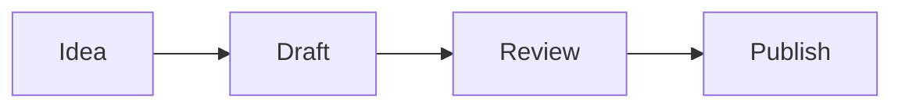

# Rhizome

Source: index.md
URL: /

Rhizome is a desktop app for working with an AI agent. What's worth keeping ends up as plain Markdown notes in a folder on your disk, called your **vault**. You can open, edit, diff and revert those notes like any other file.

> **Developer preview.** Rhizome runs on macOS, built from source. There is no signed download yet. See [Install](start/install.md).

## What you get

- **Memory you can read.** Save an answer to the vault with one click. It becomes a Markdown file. In a Git repository, every change is a commit you can undo. [Your vault is the agent's memory](concepts/vault-as-memory.md)
- **A replay of where the agent went.** Mycelium draws the folder a Prime run worked in as a map, and lights up each file the agent searched, read or edited. [Mycelium](concepts/mycelium.md)
- **Free models that switch for you.** With **Free tier (auto)**, Rhizome routes a chat across free hosted models. When a provider fails or runs out, it moves to the next one. [Free models and routing](concepts/free-models-and-routing.md)
- **Its own agent loop, or Prime.** Rhizome has its own agent loop: it sends your message to a model, runs the tools the model asks for, and repeats until the answer is done. Prime Agent is still the default engine for Chat. [Agents, engines and models](concepts/ai.md)

It also has what you'd expect from a harness and a notes app: sessions you can resume, permission modes for tools, your choice of model, a rich Markdown editor, PDF and image previews, a wiki graph, and Git built in.

## Where to go next

| If you want to… | Read |
|---|---|
| Decide whether Rhizome is for you | [Why Rhizome](start/why-rhizome.md) |
| Try it | [Install](start/install.md), then [First launch](start/first-launch.md) |
| Move over from Claude Code, Hermes Agent, Cursor or Prime | [Coming from another harness](guides/coming-from-other-harnesses.md) |
| Chat and keep what matters | [Chat with the agent](guides/use-ai-panel.md) |
| Fix something | [Chat doesn't answer](troubleshooting/chat-doesnt-answer.md) |

## Origins

Rhizome is a modified version of [Tolaria](https://github.com/refactoringhq/tolaria) by Luca Rossi (AGPL-3.0). Rhizome is AGPL-3.0-or-later. Mycelium uses [Mindwalk](https://github.com/cosmtrek/mindwalk) (MIT) © 2026 Ricko Yu. Free tier (auto) builds on [OmniRoute](https://github.com/diegosouzapw/OmniRoute) and [freellmapi](https://github.com/tashfeenahmed/freellmapi) (both MIT). See [Credits and licences](reference/credits.md).

---

# First launch

Source: start/first-launch.md
URL: /start/first-launch

In a few minutes you'll have a vault open, an answer from the agent, and one note saved to disk that you can reopen after a restart.

## 1. Choose about telemetry

The first launch may ask **Help improve Rhizome**. You can decline.

- **Accept** turns on crash reports and usage analytics.
- **Decline** turns both off.

Change either one later in Settings → Telemetry. Analytics events leave out vault content, note titles and file paths. A build made without a Sentry or PostHog key sends nothing, whatever you choose.

## 2. Chat opens

Rhizome opens on Chat. On a first launch, the sessions list opens next to it. The theme is Graphite. Earth dark, Earth light, Loam, Mycelium and Match system (on Earth) are in Settings → Appearance.

The left rail holds your sessions, the **Views** group (Research, Graph, Mycelium and History) and Settings. On a Mac, Ctrl+⌘1 to Ctrl+⌘4 open the four Views. On Windows, use Ctrl+Shift+1 to Ctrl+Shift+4.

## 3. Open or create a vault

A **vault** is the folder where Rhizome keeps notes, and where the agent's saved memory goes. You have three choices:

- **Get started with a template.** Rhizome creates a vault at `~/Documents/Rhizome Vault`. It's built on your computer; nothing is downloaded. It has starter folders, a welcome note, an `AGENTS.md` for agents, and the default work types from [Portent](../guides/structure-with-portent.md) (Project, Operation, Responsibility, Task, Event, Topic, Person). It's a Git repository with one first commit. If you already have a `Getting Started` vault from an earlier version, it still opens as before.
- **Create empty vault.** Name a new folder and choose where it goes. Rhizome adds its default settings files.
- **Open existing vault.** Pick a folder you already have. Any folder of Markdown files works, including an Obsidian vault or a Git repository.


If the folder is in Documents, Desktop or Downloads, macOS asks for permission. Allow it, or move the vault somewhere else.

Git is optional, but recommended. In a Git repository, every change, including the agent's, can be reviewed and reverted. See [Open or create a vault](open-or-create-vault.md).

## 4. Send one message

Type a message and press Enter. You should get an answer, or a clear failure:

| You see | Do this |
|---|---|
| Prime is installed, but Chat still says it's missing | Wait a few seconds. The check repeats |
| No provider key (Rhizome's engine) | Add a key in Settings → AI Agents → API model, or turn on a free provider. See [Set up models and keys](../guides/configure-ai-models.md) |
| The provider login expired (Prime) | Settings → AI Agents → Local agent → **Reconnect** on that provider, or run `prime-agent` and `/login` in a terminal |

More cases: [Chat doesn't answer](../troubleshooting/chat-doesnt-answer.md).

## 5. Save something to the vault

Under an answer you want to keep, click **Save to vault**. Rhizome writes it as a Markdown note in your vault.

Show Notes with ⌘2 (or the View menu), open the note, quit Rhizome with ⌘Q, and reopen it. The note is still there, because it's a file on your disk.

> The red window button quits Rhizome. If you turn on **Keep in taskbar** in Settings → Appearance, it hides the window instead, and you bring it back from the Dock.

## Where things are kept

| What | Where |
|---|---|
| Notes, attachments, types, saved views | Your vault folder |
| Prime chat sessions | `~/.prime/agent/sessions/` |
| Chats from Rhizome's own engine | `native-sessions/` in the app config folder (`com.rhizome.app`) |
| API keys | The system keychain |
| Settings, window size, recent vaults | Local app settings |

## Next

- [Why Rhizome](why-rhizome.md): what's different here.
- [Your vault is the agent's memory](../concepts/vault-as-memory.md)
- [Chat with the agent](../guides/use-ai-panel.md)

---

# Install

Source: start/install.md
URL: /start/install

You build Rhizome from source on a Mac and run it from there. This takes a few minutes, mostly for the first build.

> **Developer preview.** macOS only. There is no signed download, no Homebrew package and no in-app updater yet. See [Platforms and updates](../reference/platforms-and-updates.md).

## Before you start

You need:

1. macOS with the Xcode Command Line Tools (`xcode-select --install`).
2. Node.js `^20.19.0` or `>=22.12.0`.
3. pnpm.
4. Rust `1.77.2` or newer.
5. git.

Prime Agent is optional. You need it only if you keep Prime as the Chat engine, which is the default.

## Build and run

```bash
git clone https://github.com/tuckcode/rhizome-agent.git
cd rhizome-agent
./install.sh
pnpm tauri dev
```

`./install.sh` installs the project's dependencies. If Prime Agent isn't on the machine, it also downloads Prime's command-line tool, because Prime is still the default Chat engine. Rhizome doesn't include a copy of Prime or Node.

`pnpm tauri dev` builds the app and opens it.

## Pick an engine

Chat runs on one of two engines. You can switch at any time with **Chat engine** in Settings → AI Agents.

- **Prime Agent (default).** Prime runs Chat. Set it up below.
- **Rhizome's own engine.** Turn **Chat engine** on. It doesn't need Prime. Add a provider key, or use **Free tier (auto)**. See [Set up models and keys](../guides/configure-ai-models.md).

## Set up Prime

Skip this section if you use Rhizome's own engine.

The first time `prime-agent` runs in a terminal, it asks you to run `/login` and choose a model provider. You can also sign in from Settings → AI Agents → Local agent: each provider card has a **Sign in** button that runs Prime's login for you.

Prime stops when the terminal that started it closes. To keep it running in the background:

```bash
(prime-agent --mode daemon >/dev/null 2>&1 &) && sleep 2 && prime-agent status
```

## If you already have a built copy

Quit `/Applications/Rhizome Agent.app` before you run `pnpm tauri dev`. Both use the bundle id `ai.rhizome.agent`, so a second launch attaches to the copy that's already open.

## Look at the interface without an engine

```bash
pnpm dev
```

Then open `http://localhost:5202`. This runs the interface in a browser. Chat doesn't answer.

## Next

[First launch](first-launch.md): open a vault and send your first message.

---

# Open or create a vault

Source: start/open-or-create-vault.md
URL: /start/open-or-create-vault

A Rhizome vault is a folder on disk. It's where your notes live, and it's also the agent's memory: what you save from Chat lands here as Markdown. See [Your vault is the agent's memory](../concepts/vault-as-memory.md).

The folder can contain Markdown notes, attachments, type definitions, saved views, and Git metadata.

## Open an existing folder

Choose an existing folder if you already have Markdown notes. Rhizome scans `.md` files and uses frontmatter when it exists.

Good starting points:

- A folder of plain Markdown files.
- An Obsidian-style vault.
- A Git repository containing notes.

## Create a new vault

The welcome screen offers two ways to start fresh:

- **Get started with a template** creates a vault at `~/Documents/Rhizome Vault`, with starter folders, a welcome note, an `AGENTS.md`, and the default work types from [Portent](../guides/structure-with-portent.md). It's built locally and starts as a Git repository. A `Getting Started` vault from an earlier version still opens as before.
- **Create empty vault** asks for a name and a location, then adds Rhizome's default settings files.

You can bring the template back later with **Restore Rhizome Vault** in the command palette.

## Use more than one vault

You do not have to merge everything into one folder. Register each local folder as its own vault, then turn on **Use multiple vaults at the same time** in Settings → Vaults.

Once enabled, the bottom-left vault menu lets you include vaults in the unified graph. Search, quick open, wikilinks, and note lists can span the included vaults, while Git sync and commits remain tied to each vault's own repository.

## Git is recommended, not required

Rhizome works well with a plain folder of Markdown files. You can open, edit, organize, and search notes without making the vault a Git repository.

Git is recommended when you want local history, diff views, recovery, pull, push, and remote sync without a proprietary backend. If a vault is not already a repository, Rhizome can initialize one when you explicitly ask it to.

---

# Why Rhizome

Source: start/why-rhizome.md
URL: /start/why-rhizome

Rhizome gives an AI agent a memory you can see. The things worth keeping become notes in a folder you own, and you can check what the agent did to your files after the fact.

## The problem it solves

Most agent harnesses either forget everything when a session ends, or remember things in a store you can't easily read: a hidden memory file, a database, a cloud account. You can't tell what the agent "knows", fix it when it's wrong, or take it with you.

## Memory is a folder of Markdown

Rhizome keeps memory in a **vault**: an ordinary folder of Markdown files on your disk. You can start from a template with starter folders and note types, so you don't have to design a structure first. You can open the same files in any editor, search them with `grep`, and back them up however you like.

When a chat produces something worth keeping, you click **Save to vault**. Rhizome writes a note. Nothing is saved without a click unless you turn automatic saving on. [How memory works](../concepts/vault-as-memory.md)

## Git is the undo button

If the vault is a Git repository, every change to it can be committed, including the agent's changes. You can see what a note looked like before, see what changed, and revert it. Git is optional, but it's what makes agent memory safe to trust. [Git](../concepts/git.md)

## See where the agent went

**Mycelium** replays a Prime session as a map. The folder the agent worked in becomes a city of files, and each file the agent searched, read or edited lights up. When something breaks, you can see which files a run touched and where it went in circles. Mycelium uses the open-source Mindwalk project, which you install separately. [Mycelium](../concepts/mycelium.md)

## Free models, routed for you

**Free tier (auto)** sends a chat to free hosted models (Groq, Mistral, LLM7, OpenRouter's free models, NVIDIA NIM) in a fixed order. When one fails or runs out of free use, Rhizome moves to the next. Models whose free tier trains on your prompts are left out. You can add your own endpoint as the last stop. It builds on two open-source projects, OmniRoute and freellmapi. [Free models and routing](../concepts/free-models-and-routing.md)

## Rhizome runs its own loop

An **agent loop** is the cycle that sends your message to a model, runs the tools the model asks for, and repeats until the answer is done. Rhizome has its own. You can also use an **engine**: another harness that runs the loop instead. Prime Agent is the default engine today. The vault, the permissions and the memory stay with Rhizome whichever one runs.

Rhizome's own engine is new. Today it can create notes, and not much else. It can't read, search or edit files yet, and it can't search the vault. [Agents, engines and models](../concepts/ai.md)

## What will feel familiar

If you've used Claude Code, Hermes Agent, Cursor or Prime, most of the basics carry over:

| You know | In Rhizome |
|---|---|
| Sessions you can resume | Saved chats with automatic titles; Prime's session list when Prime is the engine |
| Tool approval | Permission modes: **Limited tools** and **Power User** |
| Bring your own model | Hosted providers, local models (Ollama, LM Studio), any OpenAI-compatible endpoint; keys in the system keychain |
| `CLAUDE.md` / `AGENTS.md` | A vault `AGENTS.md`, with `CLAUDE.md` kept as a compatibility file |
| MCP | Rhizome runs an MCP server, so other apps can read and write your vault |
| Past chat history | Import Claude Code chats into the vault |
| Extensions | Prime packages from Settings → Packages when Prime is the engine. Rhizome's own plugin system is planned |
| An editor | A rich Markdown editor with a raw mode, plus PDF and image previews, sheets, diagrams and whiteboards |
| A graph | The Wiki Graph: notes as nodes, links as edges |

[Coming from another harness](../guides/coming-from-other-harnesses.md) maps each one in detail.

## What it isn't yet

Rhizome is a macOS developer preview. You build it from source; there is no signed download or in-app updater. The install script fetches Prime Agent because Prime is still the default engine, but Rhizome's own engine works without it.

---

# Agents, engines and models

Source: concepts/ai.md
URL: /concepts/ai

Rhizome lets you choose what runs Chat: Prime Agent or Rhizome's own engine. Whichever you use, the vault, the permissions and the saved memory stay the same.

## Terms on this page

- **Agent loop:** the cycle that sends your message to a model, runs the tools the model asks for, and repeats until the answer is done.
- **Engine:** what runs that loop for Chat.
- **Model:** the language model the engine talks to, hosted or running locally.
- **Tool:** an action the agent can take, such as creating a note or running a command.

## Engines for Chat

| Engine | What it is | Good for |
|---|---|---|
| **Prime Agent** (default) | A separate harness Rhizome connects to. It runs sessions, tools, skills and provider login | Real agent work today: reading, searching and editing files, long runs, Prime packages |
| **Rhizome's engine** | Rhizome's own loop, built into the app. It doesn't need Prime | Choosing your own providers, including free models. Early: it can create notes, but can't read, search or edit files yet |

Switch with **Chat engine** in Settings → AI Agents. When it's on, new chats use Rhizome's engine and never call Prime, even if Prime isn't installed. The switch is only in Settings, not in the message box.

### Rhizome's engine

- **Models:** pick a catalog model, or **Free tier (auto)**. See [Free models and routing](free-models-and-routing.md). Anthropic models aren't offered here yet.
- **Tools:** `echo` and `create_note`. Power User adds `bash`. Rhizome asks you to approve each `bash` call, but `bash` doesn't run a shell yet. There are no tools to read, search or edit files, and the agent can't search the vault or old sessions.
- **Saved chats:** each chat is saved as it goes and can be reopened after you quit. Chats get a title automatically from the first exchange.
- **Errors:** a problem that doesn't stop the turn shows as a notice in the chat. A problem that does stop it, such as a missing key, ends the turn with a message that says what to fix.

### Prime Agent

Prime runs as a background service (a daemon) that Rhizome connects to. Prime owns its sessions (`~/.prime/agent/sessions/`) and its packages (Settings → Packages). Packages can use the whole machine; a vault isn't a sandbox for them.

Prime handles its own provider login. Sign in from Settings → AI Agents → Local agent, where each provider card (Anthropic, OpenAI Codex, xAI, DeepSeek and others) has a **Sign in** or **Reconnect** button. Or run `prime-agent` in a terminal and use `/login`. Prime's model list includes Anthropic models.

The same tab lists **Recognized local agents**, Prime's default model, and which models Prime may use.

## Permission modes

A **permission mode** decides what the agent may do without asking. It's set per vault.

| Mode | Rhizome's engine |
|---|---|
| **Limited tools** | `echo` and `create_note`. Asks before each note it creates |
| **Power User** | Creates notes without asking. Adds `bash`, which asks every time and doesn't run a shell yet |

Prime has no sandbox, so Prime chats always run as Power User. While Prime is the default AI target, chats on Rhizome's engine also run as Power User.

## Plugins

Rhizome will have its own plugin system: add a tool, hook into a turn, or block a tool call. It's planned, not shipped. Today, Prime packages extend Prime, and MCP lets other apps use your vault.

## Let other apps use your vault (MCP)

**MCP** (Model Context Protocol) lets other AI apps call Rhizome's tools. With it, an MCP client such as Claude Code or Cursor can read and write your vault.

Run **Set Up External AI Tools…** from the command palette (⌘K). Rhizome shows which config files it will change (for example `~/.claude.json` and `~/.cursor/mcp.json`) and writes nothing until you confirm. It needs Node.js 18 or newer, or Bun, on your `PATH`. To paste the entry yourself, use **Copy MCP config** in Settings → AI Agents → Local agent.

## Review what the agent changed

Agent edits are file edits. In a Git-backed vault, review them in the Changes view, look at the diff, and commit or revert. Save chat results you want to keep with **Save to vault**. See [Your vault is the agent's memory](vault-as-memory.md).

---

# Editor

Source: concepts/editor.md
URL: /concepts/editor

Rhizome offers a rich editor for daily writing and a raw Markdown mode for exact file control. Both modes write back to the same Markdown file.

## Rich editing

The rich editor supports blocks, slash commands, wikilinks, tables, code blocks, images, Mermaid diagrams, LaTeX-style math, and markdown-backed whiteboards.

Use it when you want to write and reorganize quickly without thinking about Markdown syntax.

## Raw mode

Raw mode shows the Markdown source directly. Use it when you need to edit YAML frontmatter, repair unusual Markdown, or make an exact text change.

Toggle raw mode with `Cmd+\` on macOS or `Ctrl+\` on Windows and Linux.

## Table of contents

The table of contents panel builds an outline from the headings in the current note, updates as you type, and jumps to a section when you click it. It's useful for long notes, procedures, research files, and generated documents. If a note has no useful headings, add clear H2 and H3 sections.

Open it from the editor toolbar, the command palette, or with `Cmd+Shift+T` on macOS (`Ctrl+Shift+T` on Windows and Linux).

## Width

Notes can use normal or wide editor width. Set the default in Settings, or override an individual note from the editor toolbar.

---

# Files, PDFs and media

Source: concepts/files-and-media.md
URL: /concepts/files-and-media

Rhizome starts with Markdown notes, but a vault can also contain images, PDFs, media files, whiteboards, and other local files.

## Previews

Select an image, PDF, media file, or other file from a folder or file list. Rhizome previews common image files, PDFs, and supported media files in the app. Other files open in the default system app.

Settings control whether PDFs, images, and unsupported files appear in All Notes. Folder browsing still shows files in their folders.

If a preview doesn't render, open the file in the default app to check that it's valid. Then check that the file is inside the active vault and isn't blocked by operating-system permissions.

## Attachments

When you paste or drop an image into a note, Rhizome copies it into the vault and links the copy from the Markdown. Attachments are normal files, so other tools can open them.

## Diagrams

Use Mermaid code blocks when a note needs a diagram that should stay plain text and versionable.

````md

````

Rhizome renders Mermaid diagrams in the editor while keeping the source in Markdown.

## Whiteboards

Whiteboards use tldraw in the editor, but their durable representation stays in Markdown. That keeps them inside the vault and versioned by Git with the rest of your notes.

## Git boundary

If generated or local-only files are ignored by Git, Rhizome can hide them from notes, search, quick open, and folders. Use this when build artifacts or private local files should not behave like vault content.

---

# Free models and routing

Source: concepts/free-models-and-routing.md
URL: /concepts/free-models-and-routing

**Free tier (auto)** runs Chat on free hosted models without you picking one. It tries free providers in a fixed order. When a provider fails, rate-limits you or runs out of free use, Rhizome moves to the next one. You can add your own endpoint as the last stop.

This works with Rhizome's own engine. Choose **Free tier (auto)** in the model picker.

## What you get

- **No model shopping.** One choice, and Rhizome picks a working free model for each step.
- **Fewer dead ends.** A provider that's down or out of quota is skipped for a while instead of failing your chat.
- **No surprise restarts.** Rhizome switches provider only before any reply text arrives. Once the model has started answering or called a tool, an error ends that step. The half-finished answer isn't silently started again somewhere else.
- **Your keys stay on your computer.** Each provider needs its own free API key, kept in the OS keychain.
- **Your prompts aren't used for training.** Models whose free tier trains on prompts are left out of the list Rhizome routes to, along with free tiers that don't renew or have poor terms.

## The providers

In order:

1. Groq
2. Mistral
3. LLM7
4. OpenRouter (free models only)
5. NVIDIA NIM
6. Your own endpoint, if you picked one

Cloudflare Workers AI is off by default. It needs an account ID as well as a key, and turning it on shows a billing warning first. When on, it's tried after NVIDIA NIM.

The order is fixed. Settings shows it read-only under **Fallback order**.

## Set it up

1. In Settings → AI Agents, open the **API model** tab and find **Free tier (auto)**.
2. For each provider you want, turn it on and paste its API key. The row shows **Key saved**, **No key**, or **Keychain error** if the keychain is locked or access was denied.
3. Optional: choose an **Own endpoint** and **Own endpoint model**: any OpenAI-compatible server you've set up as a provider, local or hosted.
4. Optional: turn on **Strict mode**. It uses only providers that document a hard stop at the free limit (Groq today), plus your own endpoint.
5. In the model picker, choose **Free tier (auto)**. Until at least one provider has a key, Settings says "Add a key to at least one provider to use Free tier (auto)."

## How a provider gets skipped

Rhizome keeps three kinds of cooldown:

- **Provider:** after repeated timeouts or server errors, the provider is paused and tried again later.
- **Key:** a key that's rate-limited cools down on its own.
- **Model:** a model that's out of quota is locked out. A daily quota stays locked until it resets at midnight UTC.

Each step has a 45-second budget for retries. Your own endpoint is still tried after the budget runs out.

## Things to know

- Free tiers change. A provider's limits, terms and models are set by that provider, not by Rhizome.
- Some free tiers are for prototyping and evaluation only.
- Settings doesn't show each provider's terms or training policy. Models that train on prompts are left out automatically, but check a provider's terms yourself before using it for real work.
- Anthropic models aren't offered by Rhizome's own engine yet. To use Claude, use Prime and sign in on the Anthropic card in Settings → AI Agents → Local agent. See [Agents, engines and models](ai.md).

## Credits

- [OmniRoute](https://github.com/diegosouzapw/OmniRoute) (MIT) © 2026 diegosouzapw: the provider catalog data and cooldown rules are ported from it.
- [freellmapi](https://github.com/tashfeenahmed/freellmapi) (MIT): used as an edge-case checklist for retries and failover. No code or hosted catalog is copied.

See [Credits and licences](../reference/credits.md).

## Related

- [Set up models and keys](../guides/configure-ai-models.md)
- [Agents, engines and models](ai.md)

---

# Git

Source: concepts/git.md
URL: /concepts/git

Git is Rhizome's recommended history and sync layer. Rhizome can work with plain Markdown folders, and Git unlocks local history, recovery, remote backup, and multi-device workflows when you want them.

Rhizome acts as a lightweight Git client for your vault. You can review changes, commit, pull, push, and inspect history without leaving the app.

## What Rhizome uses Git for

- Whole-vault commit history.
- Current diff for the vault.
- Per-note history.
- Current diff for an individual note.
- Pull and push.
- Conflict detection and resolution.
- Remote connection for local-only vaults.

## History and diffs

Each note can show its own history and current diff, so you can understand how that file changed over time or what is unsaved relative to Git.

Rhizome also shows a history of the whole vault. Use it when you want to review broader changes across multiple notes before committing or syncing.

## Local commits

You can commit changes inside Rhizome without leaving the app. This gives you useful restore points even before a remote is configured.

## Review what the agent changed

The agent's edits and saved notes are file changes like yours. In a Git-backed vault:

1. Open **Changes**, next to All Notes in the sidebar, to see every changed file.
2. Open a file's diff to see exactly what changed.
3. Commit what you want to keep, or revert what you don't.

Keep agent work in small commits, so one bad change is easy to undo. See [Your vault is the agent's memory](vault-as-memory.md).

## Remotes

Connect a compatible Git remote when you want sync or backup. Rhizome relies on your system Git authentication, so GitHub CLI, SSH keys, credential helpers, and existing Git configuration can continue to work.

---

# Inbox

Source: concepts/inbox.md
URL: /concepts/inbox

The Inbox is for notes that have been captured but not yet organized.

## Why it exists

Fast capture should not require perfect structure. The Inbox gives you a place to put incomplete notes, then process them later.

The Inbox workflow is optional. Turn it off in Settings → Workflow if you prefer every note to appear organized by default.

## Organizing Inbox notes

The review checklist is in [Organize the Inbox](../guides/organize-inbox.md).

## Keep it small

Keep the Inbox small enough that it can be reviewed in one focused pass. Rhizome works best when capture is fast and organization is deliberate.

---

# Mycelium

Source: concepts/mycelium.md
URL: /concepts/mycelium

Mycelium shows where an agent run went. It draws the folder the run worked in as a map of files, and lights up each file the agent searched, read or edited. Use it to see a run's scope at a glance, find where it went in circles, or check which files a run touched before something broke.

Mycelium uses [Mindwalk](https://github.com/cosmtrek/mindwalk) (MIT) © 2026 Ricko Yu. Mindwalk replays coding-agent sessions on a city map of a repository. You install it yourself; Rhizome doesn't include it or rebrand it.

## What you see

- **The map.** Each file in the folder is a building. The layout is fixed for a given folder, so the same file is always in the same place and two runs can be compared by eye.
- **The footprint.** Files the run searched, read or edited are highlighted. A tight cluster means a focused run. Scattered light, or the same files lit again and again, means the agent was searching or going in circles.
- **Sessions.** A column lists past sessions by title. Pick one to see its footprint, or look at the overview across all sessions.

## Before you start

1. Install Mindwalk so that the `mindwalk` program is on your path. See [Mindwalk](https://github.com/cosmtrek/mindwalk) for install steps.
2. Chat with Prime as the engine. Mycelium reads Prime sessions from `~/.prime/agent/sessions/`. It doesn't show chats from Rhizome's own engine, and the agent can't search old Mycelium sessions.

If Mindwalk is missing, Mycelium says **Install Mindwalk, then retry**.

## Open it

- In Chat, click the **Mycelium** button in the Prime session header to see the current session's footprint.
- In the sessions list, right-click a Prime session and choose **Show in Mycelium**.
- From the **Views** group on the left rail, choose Mycelium. The shortcut is Ctrl+⌘3 on a Mac and Ctrl+Shift+3 on Windows.

## Find what touched a broken file

Mycelium can't filter sessions by file yet, but the map makes it quick to check by eye:

1. Open Mycelium and look at the overview across sessions.
2. Find the file on the map. It's always in the same place.
3. Open the sessions where it lights up, newest first.
4. Open that session's chat to see what the agent did, and the vault or repository history to see the change.

## What it needs

- **A session that used tools.** A chat with no file activity draws an empty map.
- **A real working folder.** The map is drawn from the folder the run worked in. A run that only touched the vault draws a small, sparse map.

## What it isn't

Mycelium shows where a run went. It doesn't save anything to memory and doesn't replace Git. For what's in the vault, use the Graph view (see [Relationships](relationships.md)). For what changed, use the Changes view and [Git](git.md).

## Related

- [Your vault is the agent's memory](vault-as-memory.md)
- [Chat with the agent](../guides/use-ai-panel.md)

---

# Notes

Source: concepts/notes.md
URL: /concepts/notes

A note is a Markdown file with optional YAML frontmatter. Rhizome reads the first H1 as the primary title and keeps the file on disk as the durable representation.

## Anatomy

```md
---
type: Project
status: Active
belongs_to:
  - "[[workspace]]"
---

# Launch Documentation

Draft the public Rhizome docs and keep them close to code changes.
```

## Titles

The first H1 is the note title. Rhizome uses that title wherever the note is displayed: note lists, search results, wikilink suggestions, relationship pickers, tabs, and window titles.

The title is separate from the filename. The filename stays visible in the breadcrumb so you can see the file on disk, and you can rename it independently when needed.

Use the breadcrumb action to rename the file to match the title. New untitled notes can also auto-rename from the first H1 the first time they get a real title. Turn this off with **Auto-rename untitled notes from first H1** in Settings if you prefer filenames to stay unchanged until you rename them manually.

## Body links

Use `[[wikilinks]]` to connect notes from the body. Rhizome shows autocomplete suggestions while you type, and links can resolve by filename or title.

## Frontmatter

Use frontmatter for structured fields such as type, status, date, URL, and relationships. Keep free-form thinking in the body.

Some notes can be displayed with specialized editors while keeping the same file-first model. A note with `_display: sheet` opens as a spreadsheet and stores its cells in a CSV-like body, while `type` remains available for organization. See [Spreadsheets](spreadsheets.md).

---

# Properties

Source: concepts/properties.md
URL: /concepts/properties

Properties are frontmatter fields that Rhizome can display, filter, and edit.

## Suggested properties

Suggested properties are the fields Rhizome knows how to create quickly from the Properties panel. When a suggested property is missing, the panel shows a shortcut to add it with the right editor.

| Field | Purpose |
| --- | --- |
| `type` | Groups the note into a type such as Project, Person, or Topic. |
| `status` | Tracks lifecycle state such as Active, Done, or Blocked. |
| `url` | Stores a canonical external link. |
| `date` | Represents a single date. |

## System properties

Fields that start with `_` are system properties. They remain in plain text but are hidden from normal property editing.

Examples include `_icon`, `_color`, `_order`, `_sidebar_label`, `_width`, and `_pinned_properties` on type documents or notes.

## Property editing

The Properties panel is the safest place to edit structured properties. Toggle it with `Cmd+Shift+I` on macOS or `Ctrl+Shift+I` on Windows and Linux.

Date fields use Rhizome's picker, relationship fields can use wikilinks, and raw Markdown mode is available when you need direct control over YAML.

---

# Relationships

Source: concepts/relationships.md
URL: /concepts/relationships

Relationships make a vault feel like a graph instead of a pile of documents.

## Relationship fields

Any frontmatter field containing wikilinks can become a relationship. Relationship fields can point to one note or to an array of notes.

```yaml
belongs_to:
  - "[[product-work]]"
related_to:
  - "[[documentation]]"
  - "[[editor-research]]"
blocked_by:
  - "[[release-process]]"
  - "[[sync-conflicts]]"
```

Rhizome supports default relationship fields out of the box: `belongs_to`, `has`, and `related_to`. It also detects custom relationship fields dynamically when they contain wikilinks.

Default relationships have automatically computed inverses. If a note says it `belongs_to` a project, the project can show that note under its inverse `has` relationship without you writing the reverse link by hand. `related_to` works as a lateral relationship in both directions.

These outgoing and inverse relationships appear in the Properties panel and in Neighborhood mode, where the note list becomes a graph view around the selected note.

## Wikilinks

Wikilinks connect notes by name:

```md
This project belongs to [[content-systems]] and is related to [[git-workflows]].
```

Rhizome suggests targets while you type. Links can resolve by filename or title, so prefer clear titles and filenames.

## Body links versus relationship fields

Use body links when the relationship appears naturally in writing. Use frontmatter relationships when the connection is important enough to show in navigation, filters, Neighborhood mode, or the Properties panel.

## Backlinks

Rhizome can show incoming links and inverse relationships, making it easier to navigate from a note to the rest of its context.

To see all the links in the vault at once, use the [Wiki Graph](wiki-graph.md).

---

# Spreadsheets

Source: concepts/spreadsheets.md
URL: /concepts/spreadsheets

Rhizome sheets are spreadsheet notes. They keep the same file-first model as other notes, but a note with `_display: sheet` opens in a spreadsheet editor instead of the rich text editor. The note's `type` remains available for organization.

The durable file is still Markdown with YAML frontmatter. The body is CSV-like text containing cell inputs and formulas, and spreadsheet presentation state is stored as plain YAML under `_sheet`.

## Read next

- [Use Spreadsheets](../guides/use-spreadsheets.md) for the editing workflow.
- [Spreadsheet File Format](../reference/spreadsheet-format.md) for the plain-text storage contract.
- [Spreadsheet Formulas](../reference/spreadsheet-functions.md) for formula syntax, autocomplete, and IronCalc function families.

## Why sheet notes

Sheets are useful when information is better modeled as rows, columns, and formulas than as prose. Examples include budgets, revenue models, inventories, editorial calendars, lightweight trackers, and analytical scratchpads.

Rhizome does not store sheets as opaque workbook binaries. A sheet should remain:

- readable in a text editor
- diffable in Git
- editable by humans and AI agents
- available offline
- connected to the rest of the vault through types, properties, relationships, and wikilinks

## One note, one sheet

A sheet note is a single sheet. Rhizome does not expose multiple tabs inside one note.

When a model needs more than one table, create more than one sheet note and connect them with wikilinks or cross-sheet formulas. This keeps each file small, legible, and aligned with Rhizome's graph model.

For example:

- `newsletter-revenue.md`
- `sponsorship-pipeline.md`
- `refactoring-business-plan.md`

Each can be a normal `_display: sheet` note, and formulas can reference cells in another sheet note with Rhizome's wikilink cell syntax.

## Editing

The interactive sheet editor is backed by IronCalc. Rhizome uses IronCalc for spreadsheet behavior and formula evaluation, then adapts the workbook back to Rhizome's plain-text note format.

In the sheet editor:

- cell inputs that start with `=` are formulas
- non-formula cells can contain normal text, numbers, dates, and `[[wikilinks]]`
- typing `[[` in a cell opens the same note autocomplete concept used elsewhere in Rhizome
- typing a formula function name opens inline formula autocomplete for the bundled IronCalc function catalog
- right-clicking a selection exposes core formatting controls such as number formats, decimal precision, bold, italic, and clear formatting

Keyboard basics follow spreadsheet conventions:

- arrow keys move the active cell
- `Shift` with arrows extends the selection
- `Enter` starts editing the active cell
- `Escape` exits cell editing while keeping focus in the sheet
- `Delete` or `Backspace` clears the selected range
- copy and paste should preserve formulas, including Rhizome cross-sheet references

## Wikilinks in cells

Wikilinks in non-formula cells are stored as normal Rhizome wikilinks:

```csv
Project,Owner,Status
[[website-redesign]],[[person/alice]],Active
[[sponsorship-pipeline]],[[person/matteo]],Review
```

The cell still behaves like a spreadsheet cell, but the value remains a vault link that Rhizome can understand.

## Cross-sheet formulas

Rhizome adds a sheet-note reference syntax on top of IronCalc formulas:

```txt
=[[newsletter-revenue]].B5
=SUM(B2:D2)+[[sponsorship-pipeline]].E12
=[[refactoring-business-plan]].$C$18
```

The target before the dot is a normal Rhizome wikilink target. The part after the dot is an A1-style cell address.

Relative and absolute references work like spreadsheet references when copied:

- `[[revenue]].B5` can shift when pasted to another cell
- `[[revenue]].$B$5` stays fixed
- `[[revenue]].B$5` fixes the row
- `[[revenue]].$B5` fixes the column

This is not the same as an IronCalc workbook tab reference. It is Rhizome-specific syntax for referencing another sheet note in the vault.

Current cross-sheet formulas resolve single cells. Ranges across sheet notes are not a stable file-format feature yet, so prefer composing them from explicit cell references or keeping range formulas inside the same sheet note.

## Storage

A minimal sheet note looks like this:

```md
---
type: Project
_display: sheet
status: Draft
belongs_to:
  - "[[business-plan]]"
_sheet:
  frozen_rows: 1
  columns:
    A:
      width: 180
  cells:
    E6:
      num_fmt: "0.00%"
---
Metric,January,February,March,Q1 Total
Subscriptions,1200,1350,1500,=SUM(B2:D2)
Services,800,900,750,=SUM(B3:D3)
Expenses,650,700,760,=SUM(B4:D4)
Net,=B2+B3-B4,=C2+C3-C4,=D2+D3-D4,=SUM(B5:D5)
Growth,,=(C5-B5)/B5,=(D5-C5)/C5,=(E5-B5)/B5
```

Normal frontmatter stays normal Rhizome metadata. `_sheet` is system metadata for the spreadsheet editor and is hidden from normal property editing.

For the full storage contract, see [Spreadsheet File Format](../reference/spreadsheet-format.md).

## Formulas

Rhizome delegates formula calculation to IronCalc. IronCalc aims for Excel-compatible formulas, while its project documentation still describes it as work in progress. For Rhizome-specific formula behavior and the autocomplete function catalog, see [Spreadsheet Formulas](../reference/spreadsheet-functions.md).

---

# Types

Source: concepts/types.md
URL: /concepts/types

Types describe what kind of thing a note represents: Project, Person, Topic, Procedure, Event, or any category you create.

## Type field

The `type:` field assigns a note to a type.

```yaml
type: Project
```

Rhizome does not infer type from folder location. Moving a file into another folder does not change its type.

## Prefer types over folders

Types are the preferred way to group notes in Rhizome. Folders are supported for existing vaults and fallback organization, but Rhizome is built around types and relationships because they carry stronger meaning than file paths.

Use types for semantic groups such as Projects, People, Topics, Procedures, Events, and Essays. Use relationships to connect notes across those groups. This gives Rhizome better structure for navigation, filtering, properties, templates, and future automation than folder location alone.

## Type documents

Type documents are Markdown notes with `type: Type` in frontmatter. They describe how a type should appear and what new notes of that type should start with.
Use Phosphor icon names in kebab-case for `_icon`, such as `folder` or `briefcase`.

```yaml
---
type: Type
_icon: folder
_color: blue
_sidebar_label: Projects
_order: 10
---

# Project
```

Type templates can live in the Type document's `template` frontmatter field. When a hand-edited Type body contains template-like structure after its own `# TypeName` heading, Rhizome also uses that body content as the new-note template. Plain descriptive body text stays documentation-only.

## What types control

- Sidebar grouping.
- Type icon and color.
- Sidebar order and label.
- Pinned properties.
- New-note templates.

## New note defaults

Type documents can define empty properties and relationships. When you create a new note of that type, Rhizome shows placeholders for those fields so you can fill them in from the Properties panel.

If a type document gives a property a value, that value becomes the default for new notes of that type. For example, a Project type can define `status: Active` so every new project starts active until you change it.

---

# Your vault is the agent's memory

Source: concepts/vault-as-memory.md
URL: /concepts/vault-as-memory

The agent's long-term memory is your vault: a folder of Markdown files you can read, edit, search and version yourself. Nothing the agent "knows" between chats is hidden from you.

## What you get

- **You decide what's remembered.** Knowledge reaches the vault when you save it, not as a side effect of every chat.
- **Recall shows its source.** When a Prime answer uses a vault note, it's marked **From your vault**, so you can open the note and check.
- **Memory is reversible.** In a Git-backed vault, every saved or edited note is a change you can diff and revert.
- **Memory is portable.** It's plain Markdown. Open it in another editor, sync it with Git, or keep it if you stop using Rhizome.

## The memory loop

1. **Chat.** You and the agent work on something. Chat transcripts are working memory. They live with the session, not in the vault.
2. **Save.** Under a reply worth keeping, click **Save to vault**. Rhizome writes a Markdown note.
3. **Recall.** With Prime as the engine, the agent can search and open vault notes in later chats. An answer built on a note shows it came from your vault. Rhizome's own engine can't read or search the vault yet.
4. **Review.** Open, edit or delete the note like any other. With Git, look at its history and revert a change.

## Save to vault

**Save to vault** appears under a reply. It writes the note straight away. There's no preview or diff step, so review the note afterwards, or use Git to undo it.

It refuses to save when:

- **The reply is empty.** There's nothing to save.
- **No vault is attached** to the chat. It says "Attach a vault to save chat into notes".
- **The text contains a credential**, such as an API key or password. Vault notes are committed and can be pushed, so remove the secret first.
- **The same reply is already in the vault.** It names the existing note and doesn't overwrite it.

### Automatic saves are off by default

Settings → AI Agents → **Auto-save chat knowledge to the vault** saves durable decisions to the vault after each turn. It's off by default. Turn it on only if you want saves to happen without a click. Explicit saves are easier to trust.

## Bring in past chats

You can import your Claude Code chat history from Settings → AI Agents → **Import chat history**. Rhizome scans `~/.claude/projects` on your Mac. The chats become notes under `Imports/claude-code/` in the vault. A second import skips chats that are already there. Claude Code is the only source today.

## Why Git matters here

Git turns the vault into memory with a history:

- **Diff:** see what a note said before the agent or you changed it.
- **Revert:** undo one change without touching the rest.
- **Sync:** push the vault to a remote you control. Rhizome uses your system Git login.

Git is optional. A plain folder works, but it has no history to go back to. See [Git](git.md).

## What the agent reads first

A vault can hold an `AGENTS.md` file with your conventions: how notes are named, which types to use, what to avoid. The agent reads it before it works in the vault. `CLAUDE.md` is kept as a compatibility copy for tools that look for that name.

## Where things live

| What | Kept in | You can |
|---|---|---|
| Saved notes | The vault | Read, edit, diff, revert, sync |
| Imported Claude Code chats | `Imports/claude-code/` in the vault | Read, edit, link |
| Chat transcripts (Prime) | `~/.prime/agent/sessions/` | Resume from the sessions list |
| Chat transcripts (Rhizome's engine) | `native-sessions/` in the app config folder | Resume from the sessions list |
| Vault activity log | `.rhizome/events.jsonl` in the vault | Inspect |

## Related

- [Mycelium](mycelium.md): see which files a Prime run touched.
- [Vaults](vaults.md) · [Git](git.md) · [Chat with the agent](../guides/use-ai-panel.md)

---

# Vaults

Source: concepts/vaults.md
URL: /concepts/vaults

A vault is the folder Rhizome reads and writes. The filesystem is the source of truth; the app state and cache are derived from files.

## Core rules

- Notes are Markdown files.
- YAML frontmatter provides structure.
- Attachments are normal files inside the vault.
- Type definitions and saved views are also files.
- Git can track history and support remote sync.

## Why local files matter

Local files keep your notes inspectable. You can open them in another editor, search with command-line tools, back them up with your own system, and version them with Git.

Rhizome should never become the only way to read your data.

## Git is a capability

A plain folder of Markdown files can open as a vault. Git-backed vaults unlock history, changes, commits, pull, push, conflict handling, and remote setup.

If a folder is not a Git repository, Rhizome can initialize Git when you explicitly ask it to. It avoids initializing broad personal folders such as Desktop, Documents, or Downloads unless they are clearly dedicated vault folders.

## Multiple vaults at the same time

Rhizome can load multiple registered vaults into one unified graph. Turn on **Use multiple vaults at the same time** in Settings → Vaults.

After the option is enabled, open the bottom-left vault menu to include or exclude vaults from the graph. Included vaults appear together in note lists, search, quick open, backlinks, and wikilink navigation. Each note keeps a compact vault badge when Rhizome needs to disambiguate where it lives.

The selected vault still matters. Git status, commits, sync, folder navigation, saved views, and vault repair actions stay scoped to the current repository. Use `Manage vaults` from the vault menu or the Vaults settings section to rename vaults, choose colors, and set the default destination for new notes.

Cross-vault wikilinks use the target vault's stable alias when needed, for example `[[team/projects/alpha]]`. Links inside the same vault stay normal vault-relative links.

## App state versus vault state

Vault-level information should travel with the vault. Machine-specific preferences stay with the app installation.

| Vault state | App state |
| --- | --- |
| Type icons and colors | Editor zoom |
| Saved views | Window size |
| Pinned properties | Recent vault list |
| Relationship conventions | Local cache |
| Vault AI guidance files (`AGENTS.md`, `CLAUDE.md`) | AI target and Chat engine |
| Permission mode | Provider keys (in the system keychain) |
| Auto-save chat knowledge setting | Chat logs from Rhizome's engine (`native-sessions/`) |

---

# Wiki Graph

Source: concepts/wiki-graph.md
URL: /concepts/wiki-graph

The Wiki Graph shows your vault as a map. Each note is a dot, and each link between notes is a line. Use it to see which notes hold your ideas together, and which ideas you've linked to but haven't written up yet.

## Open it

Choose **Graph** in the **Views** group on the left rail. The shortcut is Ctrl+⌘2 on a Mac and Ctrl+Shift+2 on Windows.

If the vault has no links yet, the graph says "No linked notes yet — create wikilinks to grow the graph." See [Relationships](relationships.md) for how to link notes.

## What you see

- **Notes**, coloured by type. Notes with no type are marked **Untyped**.
- **Links**, drawn differently for each kind: a **Wikilink** in the body, **Belongs to**, **Related to**, and other relationship fields.
- **Notes that aren't created yet.** A note other notes link to, but that doesn't exist as a file, shows as "Not created yet". Select it and choose **Create note** to write it.

The key in the corner counts notes, links and notes not yet created.

## Find and focus

- **Find a note…** searches the graph by title.
- Turn types off to hide those notes. If every note is hidden, turn a type back on.
- **Local graph** shows only the selected note and its neighbours. **Full graph** goes back to the whole vault.
- Each note shows how many links and backlinks it has. **Open note** opens it in the editor.

## Keyboard

Arrow keys move between notes. Enter opens the selected note. Esc backs out of the local graph, then out of the graph.

## Related

- [Relationships](relationships.md)
- [Mycelium](mycelium.md): where an agent run went, instead of how notes link.

---

# Build custom views

Source: guides/build-custom-views.md
URL: /guides/build-custom-views

Custom views are saved filters for recurring questions.

## Design the question first

Before creating a view, write the question it answers. A good view is not "all fields with all filters"; it is a focused lens.

## Good view candidates

- Active projects.
- People without a recent follow-up.
- Drafts ready for review.
- Notes changed this week.
- Events in a date range.

## View definition

Saved views live as files in the vault. They describe filters, sorting, and visible columns using structured data.

## Filters

Custom views can use nested conditions, similar to Notion or Airtable filter groups. Combine `all` and `any` logic when a view needs to answer a more precise question than a single field filter can express.

Date filters support dynamic natural-language values such as `today`, `yesterday`, or `one week ago`. Use these for views that should keep moving over time, such as recent work, stale follow-ups, or upcoming events.

---

# Capture a note

Source: guides/capture-a-note.md
URL: /guides/capture-a-note

Use capture when you need to get an idea into the vault before you know where it belongs.

## Steps

1. Press `Cmd+N` on macOS or `Ctrl+N` on Windows and Linux.
2. Write a clear H1.
3. Add the rough content.
4. Leave structure for later if you are still thinking.

## Capture well

Prefer a useful title over a perfect taxonomy. You can add type, status, and relationships during inbox review.

## When to add structure immediately

Add structure while capturing when the note's type or relationships are already obvious. Otherwise, capture the idea first and organize it later.

---

# Coming from another harness

Source: guides/coming-from-other-harnesses.md
URL: /guides/coming-from-other-harnesses

If you already use Claude Code, Hermes Agent, Cursor or Prime, a lot of what you know carries over. This page maps your habits onto Rhizome, and shows what's different: memory lives in a folder you can read, and you can see where a run went.

## The one big difference

In most harnesses, memory is a file or store that belongs to the tool: `MEMORY.md`, `USER.md`, a database, a cloud account. In Rhizome, memory is your **vault**, a folder of Markdown notes. You choose what's saved with **Save to vault**. With Prime, answers that use a note say it came from your vault. With Git, every change can be diffed and reverted. See [Your vault is the agent's memory](../concepts/vault-as-memory.md).

## From Claude Code

| In Claude Code | In Rhizome |
|---|---|
| Your past sessions | Settings → AI Agents → **Import chat history** brings them into the vault as notes under `Imports/claude-code/`. See [Import Claude Code history](import-a-session.md) |
| `CLAUDE.md` | The vault's `AGENTS.md`. Rhizome keeps a `CLAUDE.md` alongside it for compatibility |
| MCP servers | Rhizome is an MCP server too. **Set Up External AI Tools…** (⌘K) adds it to Claude Code's config, so Claude Code can read and write your vault from the terminal |
| Claude models | Prime, signed in on the Anthropic card in Settings → AI Agents → Local agent. Rhizome's own engine doesn't offer Anthropic models yet |
| Permission prompts | Permission modes, **Limited tools** and **Power User**, set per vault |
| `/resume` | The sessions list. See [Sessions](sessions.md) |

Rhizome doesn't run Claude Code inside Chat. Keep using Claude Code in the terminal, connected to your vault through MCP.

## From Hermes Agent

| In Hermes | In Rhizome |
|---|---|
| `MEMORY.md` / `USER.md` | Vault notes you save on purpose. Automatic saving exists but is off by default |
| Memory writes you approve | **Save to vault** is an explicit click. It writes straight away, so review the note after, or undo with Git |
| Observable, interruptible runs | Stop any run; with Prime, send a follow-up while it works; see a Prime run's file footprint in [Mycelium](../concepts/mycelium.md) |
| Skills | Prime packages (Settings → Packages) when Prime is the engine. Rhizome's own plugin system is planned |
| Your choice of provider | Your own providers, local models or **Free tier (auto)**. Keys live in the system keychain |

## From Cursor

| In Cursor | In Rhizome |
|---|---|
| Agent chat beside your files | Chat with notes beside it (⌘2 shows Notes) |
| Cursor's MCP settings | **Set Up External AI Tools…** (⌘K) writes Rhizome's MCP entry into `~/.cursor/mcp.json`, so Cursor's agent can use your vault |
| Rules files | The vault's `AGENTS.md` |
| Model picker | Prime's models, your own providers, or **Free tier (auto)** |

Rhizome isn't a code editor. Keep Cursor for code, and use Rhizome as the place where what you and your agents learn is kept, reviewed and found again.

## From Prime Agent

Prime is still Rhizome's default engine, so nothing changes about how Prime runs:

- Your sessions stay in `~/.prime/agent/sessions/`. Rhizome lists them, lets you switch, fork and archive, and draws their footprint in Mycelium.
- Your login stays with Prime (`/login` in a terminal, or **Sign in** on a provider card in Settings → AI Agents → Local agent).
- Prime packages install from Settings → Packages. They have full system access.
- Rhizome connects to Prime's background service.

What Rhizome adds is the vault: Save to vault, recall with its source, Git history, the Graph view and Mycelium.

## Bring your own model

To skip Prime, turn on **Chat engine** in Settings → AI Agents and add a provider, or use **Free tier (auto)**. Rhizome's engine works without Prime installed. It's early: it can create notes, but can't read, search or edit files, or search the vault, yet. See [Set up models and keys](configure-ai-models.md).

## Plugins

Rhizome's own plugin system is planned, not shipped. Today you can extend Prime with packages, and other apps can reach your vault through MCP.

---

# Commit, push and AutoGit

Source: guides/commit-and-push.md
URL: /guides/commit-and-push

Rhizome can act as a lightweight Git client for a Git-enabled vault. You can manage commits and pushes yourself, or enable AutoGit to create conservative checkpoints after editing pauses or when the app is no longer active.

## Manual Git

1. Open **Changes**, next to All Notes in the sidebar.
2. Review changed files.
3. Write a short commit message.
4. Commit locally.
5. Push when a remote is configured.

If the remote has changed, pull first and resolve any conflicts. If the vault has no remote, manual commits still give you local history, diffs, and rollback.

## AutoGit

AutoGit is available in Settings for Git-enabled vaults. When enabled, Rhizome automatically commits and pushes saved local changes after an idle pause or after the app becomes inactive.

> AutoGit commits and pushes everything that's saved, including the agent's edits. Review agent changes in Changes before you turn it on, or keep it off for vaults where the agent works.

Use AutoGit when you want the safety of regular checkpoints without interrupting capture or editing. You can still inspect each note's current diff, review note history, and browse the whole-vault history before making larger manual commits.

## Use small commits

Small commits make it easier to understand what changed, roll back safely, and review AI-generated edits.

---

# Set up models and keys

Source: guides/configure-ai-models.md
URL: /guides/configure-ai-models

Choose which models Chat can use, store their API keys safely, and check that they answer. Keys are kept in your operating system's keychain, never in the vault.

## Choose an engine first

**Chat engine** in Settings → AI Agents decides who runs Chat:

- **Off (default):** Prime handles its own provider login. Sign in from Settings → AI Agents → Local agent, or run `prime-agent` in a terminal and use `/login`.
- **On:** Rhizome's own engine runs new chats with the models you set up below. It doesn't need Prime.

## Add a provider

Settings → AI Agents has three tabs. **Local model** is for models on your computer. **API model** is for hosted models and holds **Free tier (auto)**.

| Kind | Examples | Needs |
|---|---|---|
| Hosted | OpenAI, Anthropic, Gemini, OpenRouter, Groq, Mistral | API key, model ID |
| Local | Ollama, LM Studio | Base URL, model ID, usually no key |
| Your own | Any OpenAI-compatible server | Base URL, model ID, optional key and headers |

Anthropic models aren't offered by Rhizome's own Chat engine yet.

## Store the key

Under **API key storage**, pick one per provider:

- **Save locally in Rhizome (recommended).** Paste the key. Rhizome stores it in the system keychain: macOS Keychain, Windows Credential Manager, or Secret Service on Linux. Keys that older versions saved in a settings file move to the keychain the first time they're read.
- **Read from env var.** Give the variable's name. Rhizome reads the key from it.
- **No key.** For local servers that don't need one.

Don't edit a key file by hand.

## Test the connection

Click **Test model** on the provider. It sends one short request with no tools. If it passes, Settings says "Connection works. The model replied successfully."

## Use free models

**Free tier (auto)**, on the **API model** tab, lets Rhizome pick free hosted models for you and move on when one runs out. Each free provider needs its own key. See [Free models and routing](../concepts/free-models-and-routing.md).

## Pick the model for Chat

Choose a model, or **Free tier (auto)**, in the picker. The choice is saved with your settings.

## If it doesn't connect

See [Model provider connection](../troubleshooting/model-provider-connection.md).

---

# Connect a Git remote

Source: guides/connect-a-git-remote.md
URL: /guides/connect-a-git-remote

Connect a remote when you want backup or sync beyond the current machine.

## Before you start

Make sure the remote repository exists and your system Git can authenticate to it. Rhizome uses system Git rather than storing provider-specific credentials.

## Steps

1. Open the bottom status bar remote chip, or run `Add Remote` from the command palette.
2. Paste the remote URL.
3. Confirm the remote name.
4. Fetch or push according to the app prompt.

## Recommended auth

- SSH keys.
- GitHub CLI authentication.
- Existing Git credential helpers.
- macOS Keychain credentials for HTTPS remotes on macOS.

If authentication fails, see [Git Authentication](../troubleshooting/git-auth.md).

---

# Create types

Source: guides/create-types.md
URL: /guides/create-types

Create a type when several notes share the same role in your system.

## Steps

1. Run `New Type` from the command palette, or click `+` in the Types header in the sidebar.
2. Give the type a clear name.
3. Add optional icon, color, sidebar order, sidebar label, pinned properties, suggested fields, default values, or a new-note template.

You can also right-click a type in the sidebar to change its icon and color.
Type icons use Phosphor icon names in kebab-case, such as `briefcase` or `folder`.

```yaml
---
type: Type
_icon: briefcase
_color: blue
_sidebar_label: Projects
_order: 10
---

# Project
```

## Use types sparingly

A type should represent a recurring category, not a one-off label. If you only need a temporary grouping, use a saved view or property instead.

## Templates

Type documents can include a Markdown template for new notes of that type. Keep templates small and useful: a heading, a few expected fields, and the first checklist are usually enough.

You can store the template in the Type document's `template` frontmatter field. When hand-editing the Type document body, content after the Type note's own `# TypeName` heading is also used as the new-note template if it looks like template structure such as field labels, secondary headings, or checklist starters. Plain descriptive body text is ignored.

Type documents can also define fields for new notes. Empty properties and relationships become placeholders in new notes of that type. Properties with values become defaults for new notes of that type.

---

# Import Claude Code history

Source: guides/import-a-session.md
URL: /guides/import-a-session

Bring your past Claude Code chats into the vault, so what you worked out there becomes notes you can search, link and keep.

## Import

1. Open the vault you want the chats in.
2. Open Settings → AI Agents → **Import chat history**.
3. Under **Claude Code**, preview what Rhizome found, then run the import.

Rhizome scans `~/.claude/projects` on your Mac. Each chat becomes a note under `Imports/claude-code/` in the vault.

## Run it again

A second import skips chats that are already in the vault, so you can run it whenever you've done more work in Claude Code.

## Limits

- Claude Code is the only source today. Cursor and other tools aren't wired yet.
- Imported chats are notes, not sessions. You read and link them; you don't continue them in Chat.

## Related

- [Your vault is the agent's memory](../concepts/vault-as-memory.md)
- [Coming from another harness](coming-from-other-harnesses.md)

---

# Display and themes

Source: guides/manage-display-preferences.md
URL: /guides/manage-display-preferences

Display settings live with the app on this computer, unless a setting is stored in a note or the vault on purpose.

## Theme

Rhizome starts in **Graphite**. Change it in Settings → Appearance:

- **Color theme.** **Graphite** is the default warm-neutral dark skin. **Earth dark** and **Earth light** are the Earth theme; they follow the **Theme** setting below the chips: Light, Dark, or **Match system**, which follows your computer's light or dark setting. **Loam** is a warm dark skin. **Mycelium** is a green-black skin. The other themes (Nord, Dracula, Solarized and more) are fixed skins with their own light or dark look.
- **Accent color.** Sets the colour of actions, links and highlights on Graphite. Fixed themes use their own accent.

You can also switch with **Use Light Mode**, **Use Dark Mode** and **Match System** in the command palette.

## Note width

Set the default rich-editor width in Settings:

- **Normal** for focused writing.
- **Wide** for tables, diagrams, dense notes, and generated documents.

A single note can override the default from the editor toolbar. That override is stored as `_width` in the note's frontmatter.

## Sidebar labels

**Pluralize type names in sidebar** shows "Projects" for the Project type. Turn it off to show type names as written, or set `_sidebar_label` on a type document.

## What shows in All Notes

**All Notes visibility** chooses whether PDFs, images, and other non-Markdown files appear in All Notes. Folder browsing still shows them in their folders. **Toggle Gitignored Files Visibility** in the command palette shows or hides files Git ignores.

## Closing the window

The red window button quits Rhizome. Turn on **Keep in taskbar** in Settings → Appearance to hide the window instead, so you can reopen it from the Dock or taskbar.

## Language

Settings → Appearance → **Display language**. **System** follows macOS when that language is supported. Missing translations fall back to English.

---

# Organize the Inbox

Source: guides/organize-inbox.md
URL: /guides/organize-inbox

Inbox review turns quick captures into usable knowledge.

## Remove a note from Inbox

When a note is organized enough, mark it as organized. Use `Cmd+E` on macOS or `Ctrl+E` on Windows and Linux, or click the organize action in the breadcrumb bar.

That action is what removes the note from Inbox. If **Auto-advance to next Inbox item** is on in Settings → Workflow, Rhizome opens the next Inbox item immediately after you mark the current note organized.

## Review checklist

- Rename unclear notes.
- Add or correct the first H1.
- Set `type`.
- Add `status` for actionable notes.
- Add `belongs_to`, `related_to`, or other relationship fields when useful.
- Move it into a folder only if the folder adds value.
- Archive or delete notes that no longer matter.

## Make notes navigable

A note is organized when you can answer:

- What kind of thing is this?
- What is it connected to?
- What is this useful for?
- What will I do with it?

## Avoid over-structuring

Do not add fields just because they exist. Add the structure that will help future navigation, review, or automation.

---

# Sessions

Source: guides/sessions.md
URL: /guides/sessions

A **session** is one chat with the agent. Rhizome lists your sessions on the left rail, so you can go back to one and keep working.

## Two kinds of session

Which kind you get depends on the engine that ran the chat. See [Agents, engines and models](../concepts/ai.md).

| | Prime sessions | Chats on Rhizome's engine |
|---|---|---|
| Kept in | `~/.prime/agent/sessions/` | `native-sessions/` in the app config folder |
| Owned by | Prime | Rhizome |
| Titles | From Prime | Made automatically from the first exchange |
| In Mycelium | Yes | No |

## Resume a chat

Click a session in the list to reopen it, then send a message to continue.

For chats on Rhizome's engine:

- **A turn cut off by a quit** reopens as cancelled. Rhizome doesn't repeat its tools.
- **Approvals don't carry over.** Rhizome says "Earlier permissions no longer apply. Approve new actions before continuing." Approve again when the agent asks.
- **One turn at a time.** Two windows can show the same chat, but only one turn can run.
- **A damaged log** opens up to the last good line, with a warning that some history is missing. The original file is kept, and you continue in a new chat that starts from the good part.
- **A very long chat** (100 MiB of log) continues in a new chat. History isn't dropped.

## Fork and archive

- **Fork:** choose **Fork chat from here** on a past message to branch a new chat from that point.
- **Archive:** choose **Archive chat** to move a chat out of the list. **Show archived chats** brings them back into view.


## What's not saved in a session

API keys stay in the system keychain, never in session files. Rhizome removes known credentials from messages and tool results before it saves them. It can't recognise every private value, so don't paste secrets into a chat.

## Bring in chats from Claude Code

See [Import Claude Code history](import-a-session.md).

---

# Structure a vault with Portent

Source: guides/structure-with-portent.md
URL: /guides/structure-with-portent

[Portent](https://portent.md) is an open specification and template for work and personal knowledge bases.

It gives a Rhizome vault a small set of defaults for organizing information: clear types, generic graph-like relationships, and a simple lifecycle for captured knowledge. The goal is to make a knowledge base useful to humans and AI agents without forcing every person or team to design a private ontology first.

## Core questions

Portent favors convention over configuration. Instead of asking "where should this go?", it asks:

- What is this?
- What is it useful for?
- Is it captured, organized, or archived?

Those questions map naturally to Rhizome's type documents, relationship fields, Inbox, organized state, archive behavior, and custom views.

## Types

Portent defines eight default types.

PORT types are actionable:

- Project
- Operation
- Responsibility
- Task

ENTP types are non-actionable knowledge records:

- Event
- Note
- Topic
- Person

These defaults are meant to cover the common shape of personal and work knowledge with almost no setup. You can add custom types later, but Portent works best when the default vocabulary comes first.

## Relationships

Portent models knowledge as a graph. The two default relationships are:

- `belongs_to`: primary ownership, composition, or context.
- `related_to`: a looser semantic connection.

In Rhizome, these relationships can live in YAML frontmatter and point to other notes with wikilinks. That keeps the graph portable, searchable, and readable outside the app.

## Lifecycle

Portent separates capture from organization:

1. Capture information quickly so it is not lost.
2. Organize it by assigning a type and useful relationships.
3. Archive it when it has served its purpose.

Rhizome supports that lifecycle directly: the Inbox holds captured notes, organizing a note marks it ready for normal views, and archiving hides old or obsolete notes from active surfaces while keeping them available.

## Why use it

A blank vault is flexible, but it also asks you to make structural decisions before you have momentum. Portent gives you enough structure to start capturing, organizing, and retrieving notes immediately.

Because Portent is file-friendly and portable, the same model can work across local Markdown vaults, note apps, docs tools, and agent-readable knowledge bases. The spec isn't tied to Rhizome.

## In Rhizome

New vaults already include Portent's work types: Project, Operation, Responsibility, Task, Event, Topic and Person. On an older vault, use **Add default work types** in Settings → Workflow to add any that are missing. Existing types are never overwritten.

## Start from the template

You can also start from the Portent template vault:

- [refactoringhq/portent-vault-template](https://github.com/refactoringhq/portent-vault-template)

Use it as-is, rename pieces to match your language, or treat it as a reference model for your own Rhizome setup.

## Learn more

Visit [portent.md](https://portent.md) for the full spec, examples, and implementation notes.

---

# Chat with the agent

Source: guides/use-ai-panel.md
URL: /guides/use-ai-panel

Chat is where you work with the agent: ask, let it use tools, keep what's worth keeping in the vault, and pick the conversation up again later.

## Start a chat

1. Open Chat with ⌘1. Rhizome opens on Chat by default.
2. Attach a vault if you want the agent to read your notes or save to them.
3. Type a message and press Enter.

Which engine answers depends on **Chat engine** in Settings → AI Agents: Prime Agent (the default) or Rhizome's own engine. See [Agents, engines and models](../concepts/ai.md).

## While a reply is running

The message box stays open, so you can write your next message while the agent works.

- **With Prime:** press Enter to send it to the running turn. Prime queues it and reads it before its next step.
- **With Rhizome's engine:** Enter does nothing until the reply finishes. Your text stays in the box; send it when the turn ends.

Press Stop to end the run with either engine. With VoiceOver, Rhizome announces when a run starts, when a tool starts or fails, and when the reply is complete or stopped.

## Ask from the editor or about a note

- **From the editor:** press ⌘K, then Space, and type a prompt. It uses the current note as context.
- **About a note:** run **Ask the agent about this note**. Chat stays open and the note opens beside it.
- **Show or hide Chat beside your notes:** ⌘⇧L.

## Keep what matters

Under a reply worth keeping, click **Save to vault**. Rhizome writes it as a Markdown note straight away, with no preview. It won't save an empty reply, a reply with no vault attached, text that contains a credential, or a reply that's already in the vault. See [Your vault is the agent's memory](../concepts/vault-as-memory.md).

## Come back to a chat

- **Rhizome's engine:** chats are saved as they go and listed with automatic titles. Reopen one to continue it. If Rhizome quit in the middle of a turn, that turn is marked cancelled when you reopen the chat. Tool approvals you gave earlier aren't restored, so the agent asks again. Only one window can send to a chat at a time.
- **Prime:** use the sessions list to switch between, fork and archive Prime sessions.

See [Sessions](sessions.md).

## Approve tools

The vault's permission mode decides what the agent may do without asking:

- **Limited tools:** Rhizome's engine can echo and create notes, and asks before each note.
- **Power User:** creates notes without asking, and also offers `bash`, with approval each time. `bash` doesn't run a shell yet.

Prime always runs as Power User, with its local tools and no sandbox. See [Agents, engines and models](../concepts/ai.md#permission-modes).

## See what the agent did

- **Changes:** next to All Notes in the sidebar. The files that changed, with diffs. Commit or revert.
- **Mycelium:** for Prime sessions, a map of which files the run searched, read or edited. See [Mycelium](../concepts/mycelium.md).

## Requests that work well

With Prime, which can read and search the vault:

- "Find notes related to this project and summarize what's open."
- "Draft a weekly review from the notes linked here."
- "What did we decide about X? Check the vault."

With Rhizome's engine, which can create notes but not read them yet:

- "Write up these meeting notes as a note called *Weekly sync*."

---

# Use the command palette

Source: guides/use-command-palette.md
URL: /guides/use-command-palette

The command palette is the fastest way to move around Rhizome.

Open it with `Cmd+K` on macOS, or `Ctrl+K` on Windows and Linux.

## Ask the agent from the palette

Type a space first to switch the palette to a prompt. It sends the prompt to Chat with the current note as context.

## Common commands

- **New Note** and **Search Notes**.
- **Go to Inbox**, **Go to All Notes**, **Go to Changes** and **Go to History**.
- **Open Research**.
- **Toggle AI Panel** and **New AI chat**.
- **Ask the agent about this note**.
- **Toggle Raw Editor**.
- **Open in New Window**.
- **Use Light Mode**, **Use Dark Mode** and **Match System**.
- **Add Remote to Current Vault** and **View Pending Changes**.
- **Reload Vault**, **Repair Vault** and **Restore Rhizome Vault**.
- **Set Up External AI Tools…** to connect Claude Code, Cursor and other MCP clients to your vault.
- **Open Settings**, **Open AI Agents** and **Keyboard Shortcuts**.

## Keyboard-first

Use the palette when you know what you want but don't want to hunt through panels. It's also the place to discover commands as the app grows. For shortcuts, see [Keyboard shortcuts](../reference/keyboard-shortcuts.md).

---

# Use spreadsheets

Source: guides/use-spreadsheets.md
URL: /guides/use-spreadsheets

Rhizome spreadsheets are sheet notes: Markdown files with frontmatter and a CSV-like body that open in a spreadsheet editor when their `Display as` value is `Sheet`.

Use a sheet note when a model needs rows, columns, calculations, or repeated numeric editing. Use a normal note when the main artifact is prose.

## Create a sheet

Use the command palette action `New Sheet`, or create/open a note and set its `Display as` to `Sheet` from the Properties panel. `Type` remains separate and can still be `Note`, `Project`, `Responsibility`, or any other Rhizome type.

When a note is a sheet:

- the YAML frontmatter remains available for type, status, relationships, wikilinks, and custom properties
- `_display: sheet` tells Rhizome to display the note with the spreadsheet editor
- the body is the sheet itself
- there is no rich-text body around the table
- the editor switches from the text editor to the spreadsheet editor

## Enter values

Click a cell and type a value. Non-formula values can be text, numbers, dates, or wikilinks.

Press `Enter` on a selected cell to edit the cell. Press `Escape` while editing to leave cell editing and keep focus in the sheet.

Use `Delete` or `Backspace` to clear the selected cell or range.

## Enter formulas

Formulas start with `=`.

```txt
=B2+B3-B4
=SUM(B2:D2)
=ROUND(E6, 2)
=IF(E6>0, "Up", "Down")
```

Rhizome shows inline formula autocomplete while you type. The autocomplete list is built from the implemented function catalog in the bundled IronCalc engine; formula evaluation is still handled by IronCalc.

See [Spreadsheet Formulas](../reference/spreadsheet-functions.md) for syntax, supported examples, and links to the full IronCalc formula reference.

## Select and edit ranges

The sheet editor follows spreadsheet conventions:

- arrow keys move the active cell
- `Shift` plus arrow keys extends the selection
- drag to select a range
- copy and paste preserves formulas where possible
- cut and paste moves formulas and shifts relative references
- right-click a selected cell or range to apply formatting

Right-click actions apply to the current selection. Keep a multi-cell selection active before opening the context menu when you want to format several cells together.

## Format cells

Use the context menu for common formatting:

- number formats such as plain numbers, currency, and percentages
- decimal precision
- bold and italic text
- alignment and clearing formatting when available

Formatting is stored as plain YAML under `_sheet`, not in an opaque workbook blob. For example, percentage formatting for `E6` is stored as:

```yaml
_sheet:
  cells:
    E6:
      num_fmt: "0.00%"
```

See [Spreadsheet File Format](../reference/spreadsheet-format.md) for the full storage model.

## Add wikilinks

Type `[[` in a cell to open note autocomplete.

```csv
Project,Owner,Status
[[website-redesign]],[[person/alice]],Active
[[sponsorship-pipeline]],[[person/matteo]],Review
```

When the cell is not being edited, Rhizome renders the wikilink like other note links. When you edit the cell, the raw `[[wikilink]]` syntax is shown again.

Command-click a wikilink in a sheet cell to open the linked note.

## Reference another sheet note

Formulas can read a cell from another sheet note with Rhizome's wikilink cell syntax:

```txt
=[[newsletter-revenue]].B5
=SUM(B2:D2)+[[sponsorship-pipeline]].E12
=ROUND([[business-plan]].$E$12, 2)
```

The part inside `[[...]]` resolves like a normal Rhizome wikilink. The part after the dot is an A1-style cell reference.

Use absolute markers when copying formulas:

| Reference | Copy behavior |
| --- | --- |
| `[[revenue]].B5` | row and column can shift |
| `[[revenue]].$B$5` | row and column stay fixed |
| `[[revenue]].B$5` | row fixed, column can shift |
| `[[revenue]].$B5` | column fixed, row can shift |

Cross-sheet references currently resolve single cells. Keep range formulas inside one sheet note.

## Work with the raw file

A sheet file remains readable text:

```md
---
type: Project
_display: sheet
status: Draft
belongs_to:
  - "[[business-plan]]"
_sheet:
  frozen_rows: 1
  columns:
    A:
      width: 180
---
Metric,January,February,March,Q1 Total
Subscriptions,1200,1350,1500,=SUM(B2:D2)
Services,800,900,750,=SUM(B3:D3)
Expenses,650,700,760,=SUM(B4:D4)
Net,=B2+B3-B4,=C2+C3-C4,=D2+D3-D4,=SUM(B5:D5)
```

When editing this file with scripts or AI agents, parse the body as CSV and preserve formulas as formulas. Do not replace formulas with displayed values.

---

# Contribute

Source: reference/contribute.md
URL: /reference/contribute

Rhizome is free and open source under AGPL-3.0-or-later. All of these happen on GitHub.

## Report a bug

Open an issue on [GitHub Issues](https://github.com/tuckcode/rhizome-agent/issues). Include what happened, what you expected, and the steps to reproduce it.

From inside Rhizome, open **Contribute** from the command palette or Settings → About. It can copy diagnostics with personal details removed, for you to paste into the issue.

## Suggest a feature

Search [GitHub Issues](https://github.com/tuckcode/rhizome-agent/issues) first. Comment on an existing request, or open a new one if yours is new.

## Report a security issue

Don't open a public issue. Follow [SECURITY.md](https://github.com/tuckcode/rhizome-agent/blob/main/SECURITY.md).

## Contribute code

Small, focused pull requests are welcome. Read [CONTRIBUTING.md](https://github.com/tuckcode/rhizome-agent/blob/main/CONTRIBUTING.md) for the local workflow, then open a pull request on [GitHub](https://github.com/tuckcode/rhizome-agent/pulls).

## Origins

Rhizome is a modified version of [Tolaria](https://github.com/refactoringhq/tolaria) by Luca Rossi. See [Credits and licences](credits.md).

---

# Credits and licences

Source: reference/credits.md
URL: /reference/credits

Rhizome is free software under AGPL-3.0-or-later. It builds on the projects below. Copied or ported code is also listed in the repository's `THIRD_PARTY_NOTICES` and `docs/vendored-sources.md`.

| Project | Licence | What Rhizome uses |
|---|---|---|
| [Tolaria](https://github.com/refactoringhq/tolaria) by Luca Rossi | AGPL-3.0 | Rhizome is a modified version of Tolaria: the vault, editor and note model |
| [Mindwalk](https://github.com/cosmtrek/mindwalk) © 2026 Ricko Yu | MIT | The map engine behind [Mycelium](../concepts/mycelium.md). You install it separately; Rhizome calls it |
| [OmniRoute](https://github.com/diegosouzapw/OmniRoute) © 2026 diegosouzapw | MIT | [Free tier (auto)](../concepts/free-models-and-routing.md): the provider catalog data and cooldown rules are ported from it |
| [freellmapi](https://github.com/tashfeenahmed/freellmapi) | MIT | Free tier (auto): used as an edge-case checklist for retries and failover. No code or hosted catalog is copied |
| [Portent](https://portent.md) ([portent-vault-template](https://github.com/refactoringhq/portent-vault-template) at commit `87c4adc`) © 2026 Refactoring | MIT | The default work types for new vaults, copied into `src-tauri/src/vault/config_seed.rs`. See [Structure a vault with Portent](../guides/structure-with-portent.md) |
| [IronCalc](https://github.com/ironcalc/IronCalc) | MIT or Apache-2.0 | Spreadsheet engine for sheet notes |

---

# File layout

Source: reference/file-layout.md
URL: /reference/file-layout

Rhizome is not opinionated about folder structure. It finds notes recursively across the whole vault, stores new notes in the root by default, and uses types and relationships for real organization.

```txt
my-vault/
  project-alpha.md
  weekly-review.md
  research/
    source-notes.md
  attachments/
    diagram.png
    source.pdf
  project.md
  person.md
  views/
    active-projects.yml
```

## Root notes

Rhizome works well with a flat vault. Folders are optional and can be useful for compatibility with other tools, but they are not required for people, projects, topics, or any other note category.

Type is not inferred from folder location. It comes from frontmatter, and relationships are expressed with wikilinks in fields. That is what Rhizome uses for the sidebar, Properties panel, search, custom views, and neighborhood navigation.

## Special folders

| Folder | Purpose |
| --- | --- |
| `views/` | Saved custom views. |
| `attachments/` | Images and other attached files. |
| `Imports/` | Chats brought in with **Import chat history**, for example `Imports/claude-code/`. |
| `.rhizome/` | Rhizome's own vault files, such as the activity log `events.jsonl`. |

## Agent files

| File | Purpose |
| --- | --- |
| `AGENTS.md` | Your conventions for AI agents working in this vault. |
| `CLAUDE.md` | A compatibility copy for tools that look for that name. |

Chats from Rhizome's engine aren't kept in the vault. They're in `native-sessions/` in the app config folder. Prime keeps its sessions in `~/.prime/agent/sessions/`.

PDFs, images, and other non-Markdown files stay as normal files. Folder browsing can show them in place, and Settings controls whether PDFs, images, and unsupported files appear in All Notes.

Whiteboards are Markdown files with durable tldraw data, so they belong with notes rather than in `attachments/`.

Spreadsheets are also Markdown files. A note with `_display: sheet` stores ordinary frontmatter plus a CSV-like body and opens in the sheet editor.

Type definitions are Markdown notes with `type: Type` in frontmatter. New type documents are normal notes, and existing type documents in older folders still work.

## Git files

If the vault is a Git repository, `.git/` belongs to Git. Rhizome reads Git state but does not treat `.git/` as notes.

---

# Frontmatter fields

Source: reference/frontmatter-fields.md
URL: /reference/frontmatter-fields

Rhizome uses conventions instead of a required schema.

| Field | Meaning |
| --- | --- |
| `type` | The note's entity type. |
| `status` | Lifecycle state. |
| `icon` | Per-note icon you set as a normal property. |
| `url` | External URL. |
| `date` | Single date. |
| `belongs_to` | Parent relationship. |
| `related_to` | Lateral relationship. |
| `has` | Contained relationship. |
| `_width` | Per-note editor width override. |
| `_display` | Display mode. Omit for text notes; use `sheet` for spreadsheet notes. |
| `_icon`, `_color` | Type or note appearance metadata. `_icon` values use Phosphor icon names in kebab-case, emoji, or HTTP(S) image URLs. |
| `_sidebar_label`, `_order` | Type sidebar label and order. |
| `_pinned_properties` | Properties pinned for a type. |
| `_sheet` | Sheet-note presentation metadata such as grid settings, column widths, row heights, and cell formatting. |

`icon` is an ordinary property you can see and edit. `_icon` is the system field Rhizome writes when you pick an icon from the app, and it's hidden from property editing.

## Custom fields

You can add your own fields. If a field contains wikilinks, Rhizome can treat it as a relationship.

## System fields

Fields starting with `_` are reserved for system behavior and hidden from standard property editing. They remain plain YAML, so they can still be inspected or changed in raw mode when needed.

Nested keys under a system field are also system-owned. For example, `_sheet.cells.B6.num_fmt` belongs to the sheet editor and should not appear as a normal user property.

---

# Keyboard shortcuts

Source: reference/keyboard-shortcuts.md
URL: /reference/keyboard-shortcuts

Shortcuts are listed for macOS and for Windows and Linux. This list comes from the app's command manifest (`src/shared/appCommandManifest.json`). Press ⌘/ in the app to see the current list.

## General

| Action | macOS | Windows and Linux |
| --- | --- | --- |
| Open the command palette | `Cmd+K` | `Ctrl+K` |
| Quick open notes and files | `Cmd+P` or `Cmd+O` | `Ctrl+P` or `Ctrl+O` |
| Open Settings | `Cmd+,` | `Ctrl+,` |
| Show keyboard shortcuts | `Cmd+/` | `Ctrl+/` |
| Reload the vault | `Cmd+Shift+R` | `Ctrl+Shift+R` |

## Layouts and Views

| Action | macOS | Windows and Linux |
| --- | --- | --- |
| Chat layout | `Cmd+1` | `Ctrl+1` |
| Notes layout | `Cmd+2` | `Ctrl+2` |
| Workbench layout | `Cmd+3` | `Ctrl+3` |
| Read layout | `Cmd+4` | `Ctrl+4` |
| Open Research (Views) | `Ctrl+Cmd+1` | `Ctrl+Shift+1` |
| Open Graph (Views) | `Ctrl+Cmd+2` | `Ctrl+Shift+2` |
| Open Mycelium (Views) | `Ctrl+Cmd+3` | `Ctrl+Shift+3` |
| Open History (Views) | `Ctrl+Cmd+4` | `Ctrl+Shift+4` |
| Show or hide Chat beside your notes | `Cmd+Shift+L` | `Ctrl+Shift+L` |

## Notes

| Action | macOS | Windows and Linux |
| --- | --- | --- |
| Create a new note | `Cmd+N` | `Ctrl+N` |
| Save the current note | `Cmd+S` | `Ctrl+S` |
| Mark the current Inbox note organized | `Cmd+E` | `Ctrl+E` |
| Toggle favorite for the current note | `Cmd+D` | `Ctrl+D` |
| Open the current note in a new window | `Cmd+Shift+O` | `Ctrl+Shift+O` |
| Delete the current note | `Cmd+Backspace` | `Ctrl+Backspace` |

## Editing

| Action | macOS | Windows and Linux |
| --- | --- | --- |
| Undo | `Cmd+Z` | `Ctrl+Z` |
| Redo | `Cmd+Shift+Z` | `Ctrl+Shift+Z` |
| Find in the current note | `Cmd+F` | `Ctrl+F` |
| Search the vault | `Cmd+Shift+F` | `Ctrl+Shift+F` |
| Paste without formatting | `Cmd+Shift+V` | `Ctrl+Shift+V` |
| Toggle raw Markdown mode | `Cmd+\` | `Ctrl+\` |
| Toggle the Properties panel | `Cmd+Shift+I` | `Ctrl+Shift+I` |
| Toggle the table of contents | `Cmd+Shift+T` | `Ctrl+Shift+T` |

## Navigation and zoom

| Action | macOS | Windows and Linux |
| --- | --- | --- |
| Go back | `Cmd+←` | `Ctrl+←` |
| Go forward | `Cmd+→` | `Ctrl+→` |
| Zoom in | `Cmd+=` | `Ctrl+=` |
| Zoom out | `Cmd+-` | `Ctrl+-` |
| Actual size | `Cmd+0` | `Ctrl+0` |

## Not on a shortcut

**Go to Changes** has no shortcut. Run it from the command palette, or click Changes next to All Notes in the sidebar.

Some shortcuts differ by platform because macOS, Windows and Linux reserve different key combinations.

---

# Platforms and updates

Source: reference/platforms-and-updates.md
URL: /reference/platforms-and-updates

Rhizome is a developer preview. It's built and tested on macOS, from source.

| Platform | Status |
|---|---|
| macOS | The preview platform. Build from source; see [Install](../start/install.md) |
| Windows | Builds from source, but isn't supported for daily use yet |
| Linux | Builds from source, but hasn't been checked as an install for someone new |

There is no signed download, no Homebrew package, and no release channel yet. The app reports version `0.1.0`. That's the bundle version, not a promise about every macOS release.

## Update Rhizome

There's no in-app updater. To update:

1. Commit or push important vault changes first. Your notes are local files, but a clean Git state makes recovery simpler.
2. Pull the latest code: `git pull` in your `rhizome-agent` folder.
3. Run `./install.sh`, then `pnpm tauri dev`.

If you built an `.app` before, replace it with a new build.

## Update Prime

If you use Prime as the Chat engine, Rhizome checks for Prime updates but never installs one on its own. When an update is ready, click **Update now**. If it fails, update Prime from a terminal.

## Report a platform bug

Open an issue on [GitHub](https://github.com/tuckcode/rhizome-agent/issues) and include:

- Rhizome version.
- Operating system, version and CPU architecture.
- Whether the vault is local-only or connected to a remote.
- Steps to reproduce.

---

# Spreadsheet file format

Source: reference/spreadsheet-format.md
URL: /reference/spreadsheet-format

Sheet notes are Markdown files with YAML frontmatter and a CSV-like body. The note uses `_display: sheet` when it should open in the spreadsheet editor. The `type` field remains ordinary semantic metadata.

For editing workflows, see [Use Spreadsheets](../guides/use-spreadsheets.md). For formula syntax and function references, see [Spreadsheet Formulas](spreadsheet-functions.md).

## Structure

```md
---
type: Project
_display: sheet
tags:
  - planning
_sheet:
  show_grid_lines: true
  frozen_rows: 1
  frozen_columns: 1
  columns:
    A:
      width: 180
  rows:
    "1":
      height: 32
  cells:
    E6:
      num_fmt: "0.00%"
      bold: true
---
Metric,January,February,March,Q1 Total
Subscriptions,1200,1350,1500,=SUM(B2:D2)
Expenses,650,700,760,=SUM(B3:D3)
Net,=B2-B3,=C2-C3,=D2-D3,=SUM(B4:D4)
Growth,,=(C4-B4)/B4,=(D4-C4)/C4,=(E4-B4)/B4
```

The frontmatter stores note metadata. The body stores rows and cells. There is no Markdown table wrapper, fenced code block, or embedded workbook blob.

## Frontmatter

All ordinary Rhizome fields remain available:

- `type`
- `status`
- `date`
- `tags`
- `url`
- relationship fields such as `belongs_to`, `related_to`, and custom wikilink properties

The `_display: sheet` field is the display-as marker. Omit it for ordinary text notes.

The `_sheet` key is reserved for spreadsheet presentation metadata. It follows the same system-field convention as other underscore-prefixed Rhizome fields: hidden from normal property editing, but visible and editable in raw source.

## Body

The body is CSV-like text:

- rows are separated by line breaks
- cells are separated by commas
- cells containing commas, quotes, or line breaks are quoted
- quotes inside quoted cells are escaped by doubling them
- empty trailing rows and columns may be omitted on save

Any cell whose input starts with `=` is treated as a formula. Other cells are treated as literal values.

## `_sheet` metadata

Rhizome stores spreadsheet presentation state in `_sheet` as plain YAML.

| Field | Meaning |
| --- | --- |
| `show_grid_lines` | Whether grid lines are shown. |
| `frozen_rows` | Number of frozen rows from the top. |
| `frozen_columns` | Number of frozen columns from the left. |
| `columns.<column>.width` | Custom column width, keyed by column letter such as `A` or `BC`. |
| `rows."<row>".height` | Custom row height, keyed by one-based row number. |
| `cells.<cell>.num_fmt` | Number format code for a cell. |
| `cells.<cell>.bold` | Bold text style. |
| `cells.<cell>.italic` | Italic text style. |
| `cells.<cell>.underline` | Underline text style. |
| `cells.<cell>.strike` | Strikethrough text style. |
| `cells.<cell>.font_size` | Font size. |
| `cells.<cell>.font_color` | Text color. |
| `cells.<cell>.fill_color` | Cell fill color. |
| `cells.<cell>.horizontal_align` | Horizontal alignment. |
| `cells.<cell>.vertical_align` | Vertical alignment. |
| `cells.<cell>.wrap_text` | Text wrapping. |
| `cells.<cell>.border_top` | Top border style. |
| `cells.<cell>.border_right` | Right border style. |
| `cells.<cell>.border_bottom` | Bottom border style. |
| `cells.<cell>.border_left` | Left border style. |

Cell metadata is keyed by A1-style cell addresses such as `A1`, `B12`, or `AA30`.

Border values are stored as a style name with an optional color, for example:

```yaml
border_bottom: "thin #d0d7de"
```

## Number formats

Number formats are stored in `num_fmt` using spreadsheet-style format codes. Common examples:

| Format | Example output |
| --- | --- |
| `#,##0` | `1,250` |
| `#,##0.00` | `1,250.50` |
| `0.00%` | `12.35%` |
| `$#,##0.00` | `$1,250.50` |
| `yyyy-mm-dd` | `2026-06-15` |

These formats affect presentation, not the underlying cell input in the CSV body.

## Markdown style import

When Rhizome imports a non-formula CSV cell, simple Markdown wrappers can seed initial styles:

| Cell text | Stored value | Style |
| --- | --- | --- |
| `**Revenue**` | `Revenue` | bold |
| `_Estimate_` | `Estimate` | italic |
| `***Total***` | `Total` | bold and italic |
| `~~Removed~~` | `Removed` | strike |

After save, the style belongs in `_sheet` metadata and the body keeps the unwrapped text.

## Wikilinks

Non-formula cells can store normal Rhizome wikilinks:

```csv
Account,Source
Newsletter,[[newsletter-revenue]]
Sponsors,[[sponsorship-pipeline]]
```

Formula cells can reference another sheet note with Rhizome's cross-sheet syntax:

```txt
=[[newsletter-revenue]].B5
=ROUND([[business-plan]].$E$12, 2)
```

Cross-sheet references resolve another sheet note by wikilink target, then read a single A1-style cell. Circular references and very deep chains are treated as unresolved.

## Guidance for agents and scripts

When editing a sheet note programmatically:

- preserve the YAML frontmatter delimiter and ordinary Rhizome fields
- keep `_display: sheet` when the file should display as a spreadsheet
- keep spreadsheet presentation state under `_sheet`
- parse and serialize the body as CSV, not by splitting on every comma manually
- preserve formulas as formulas, including `[[sheet]].A1` references
- avoid converting formulas to their displayed values
- quote CSV cells when they contain commas, quotes, or line breaks
- do not add workbook tabs inside one note; create another note with `_display: sheet` instead
- do not store opaque binary workbook state in the Markdown file

If a script cannot safely preserve `_sheet`, it should leave that block untouched and edit only the CSV body cells it understands.

---

# Spreadsheet formulas

Source: reference/spreadsheet-functions.md
URL: /reference/spreadsheet-functions

Formula cells start with `=` and are evaluated by IronCalc through Rhizome's sheet editor.

Rhizome adds vault-aware sheet references on top of the normal spreadsheet formula model. Everything else should be treated as IronCalc formula behavior. IronCalc aims for Excel-compatible formulas, but the upstream project is still evolving, so verify advanced formulas against the IronCalc docs when precision matters.

## Basic syntax

| Syntax | Meaning |
| --- | --- |
| `=B2+B3-B4` | Arithmetic over cells. |
| `=SUM(B2:D2)` | Function call over a range. |
| `=ROUND(E6, 2)` | Function call with arguments. |
| `=IF(E6>0, "Up", "Down")` | Conditional expression. |
| `=$B$2` | Absolute column and row reference. |
| `=B$2` | Relative column, absolute row. |
| `=$B2` | Absolute column, relative row. |
| `=B2:D10` | A range in the current sheet note. |
| `="Q" & 1` | Text concatenation. |

Use parentheses when a model depends on precedence:

```txt
=(B2+B3-B4)/B5
```

## Rhizome cross-sheet references

Rhizome supports wikilink cell references for values that live in another sheet note:

```txt
=[[newsletter-revenue]].B5
=SUM(B2:D2)+[[sponsorship-pipeline]].E12
=ROUND([[business-plan]].$E$12, 2)
```

The target inside `[[...]]` resolves like a normal Rhizome wikilink. The cell address after the dot uses A1 notation.

Absolute markers follow spreadsheet copy behavior:

| Reference | Copy behavior |
| --- | --- |
| `[[revenue]].B5` | row and column can shift |
| `[[revenue]].$B$5` | row and column stay fixed |
| `[[revenue]].B$5` | row fixed, column can shift |
| `[[revenue]].$B5` | column fixed, row can shift |

Cross-sheet references currently resolve single cells. Keep range formulas inside one sheet note until cross-note ranges are explicitly supported.

## Autocomplete functions

Rhizome's formula autocomplete exposes the implemented function catalog from the bundled IronCalc engine. The current catalog has 195 functions.

The dropdown shows a small ranked set of matches while you type. Keep typing to narrow the result list. Function names with digits and dots, such as `BIN2DEC` and `ERFC.PRECISE`, are supported.

### Logical

`AND`, `FALSE`, `IF`, `IFERROR`, `IFNA`, `IFS`, `NOT`, `OR`, `SWITCH`, `TRUE`, `XOR`

### Math and trigonometry

`ABS`, `ACOS`, `ACOSH`, `ASIN`, `ASINH`, `ATAN`, `ATAN2`, `ATANH`, `COS`, `COSH`, `PI`, `POWER`, `PRODUCT`, `RAND`, `RANDBETWEEN`, `ROUND`, `ROUNDDOWN`, `ROUNDUP`, `SIN`, `SINH`, `SQRT`, `SQRTPI`, `SUM`, `SUMIF`, `SUMIFS`, `TAN`, `TANH`, `SUBTOTAL`

### Lookup and reference

`CHOOSE`, `COLUMN`, `COLUMNS`, `HLOOKUP`, `INDEX`, `INDIRECT`, `LOOKUP`, `MATCH`, `OFFSET`, `ROW`, `ROWS`, `VLOOKUP`, `XLOOKUP`

### Text

`CONCAT`, `CONCATENATE`, `EXACT`, `FIND`, `LEFT`, `LEN`, `LOWER`, `MID`, `REPT`, `RIGHT`, `SEARCH`, `SUBSTITUTE`, `T`, `TEXT`, `TEXTAFTER`, `TEXTBEFORE`, `TEXTJOIN`, `TRIM`, `UNICODE`, `UPPER`, `VALUE`, `VALUETOTEXT`

### Information

`ERROR.TYPE`, `FORMULATEXT`, `ISBLANK`, `ISERR`, `ISERROR`, `ISEVEN`, `ISFORMULA`, `ISLOGICAL`, `ISNA`, `ISNONTEXT`, `ISNUMBER`, `ISODD`, `ISREF`, `ISTEXT`, `NA`, `SHEET`, `TYPE`

### Statistical

`AVERAGE`, `AVERAGEA`, `AVERAGEIF`, `AVERAGEIFS`, `COUNT`, `COUNTA`, `COUNTBLANK`, `COUNTIF`, `COUNTIFS`, `GEOMEAN`, `MAX`, `MAXIFS`, `MIN`, `MINIFS`

### Date and time

`DATE`, `DAY`, `EDATE`, `EOMONTH`, `MONTH`, `NOW`, `TODAY`, `YEAR`

### Financial

`CUMIPMT`, `CUMPRINC`, `DB`, `DDB`, `DOLLARDE`, `DOLLARFR`, `EFFECT`, `FV`, `IPMT`, `IRR`, `ISPMT`, `MIRR`, `NOMINAL`, `NPER`, `NPV`, `PDURATION`, `PMT`, `PPMT`, `PV`, `RATE`, `RRI`, `SLN`, `SYD`, `TBILLEQ`, `TBILLPRICE`, `TBILLYIELD`, `XIRR`, `XNPV`

### Engineering

`BESSELI`, `BESSELJ`, `BESSELK`, `BESSELY`, `BIN2DEC`, `BIN2HEX`, `BIN2OCT`, `BITAND`, `BITLSHIFT`, `BITOR`, `BITRSHIFT`, `BITXOR`, `COMPLEX`, `CONVERT`, `DEC2BIN`, `DEC2HEX`, `DEC2OCT`, `DELTA`, `ERF`, `ERF.PRECISE`, `ERFC`, `ERFC.PRECISE`, `GESTEP`, `HEX2BIN`, `HEX2DEC`, `HEX2OCT`, `IMABS`, `IMAGINARY`, `IMARGUMENT`, `IMCONJUGATE`, `IMCOS`, `IMCOSH`, `IMCOT`, `IMCSC`, `IMCSCH`, `IMDIV`, `IMEXP`, `IMLN`, `IMLOG10`, `IMLOG2`, `IMPOWER`, `IMPRODUCT`, `IMREAL`, `IMSEC`, `IMSECH`, `IMSIN`, `IMSINH`, `IMSQRT`, `IMSUB`, `IMSUM`, `IMTAN`, `OCT2BIN`, `OCT2DEC`, `OCT2HEX`

## Examples

### Totals

```txt
=SUM(B2:D2)
=B2+B3-B4
=SUM(B2:D2)-SUM(B4:D4)
```

### Growth and percentages

```txt
=(C5-B5)/B5
=IF(B5=0, 0, (C5-B5)/B5)
=ROUND((C5-B5)/B5, 4)
```

Format the result as a percentage with a cell `num_fmt` such as `0.00%`.

### Conditional logic

```txt
=IF(E5>10000, "On track", "Review")
=IFS(E5>10000, "High", E5>5000, "Medium", TRUE, "Low")
=IFERROR(B5/B4, 0)
```

### Dates

```txt
=TODAY()
=DATE(2026, 6, 15)
=YEAR(TODAY())
=MONTH(TODAY())
```

### Text

```txt
=CONCAT(A2, " - ", B2)
=UPPER(A2)
=TRIM(A2)
=TEXT(B2, "$#,##0.00")
```

### Lookup

```txt
=INDEX(B2:E10, 3, 2)
=MATCH("Revenue", A2:A20, 0)
=VLOOKUP("Revenue", A2:E20, 5, FALSE)
=XLOOKUP("Revenue", A2:A20, E2:E20)
```

### Cross-sheet model

```txt
=[[newsletter-revenue]].E5
=SUM(B2:D2)+[[sponsorship-pipeline]].E12
=IF([[business-plan]].$E$12>0, [[business-plan]].$E$12, 0)
```

## IronCalc function families

IronCalc documents formulas by category. Use these upstream pages for detailed syntax and examples. The upstream documentation may include newer functions that are not yet present in Rhizome's bundled IronCalc version.

| Family | Link |
| --- | --- |
| Lookup and reference | [IronCalc lookup and reference](https://docs.ironcalc.com/functions/lookup-and-reference.html) |
| Financial | [IronCalc financial](https://docs.ironcalc.com/functions/financial.html) |
| Engineering | [IronCalc engineering](https://docs.ironcalc.com/functions/engineering.html) |
| Database | [IronCalc database](https://docs.ironcalc.com/functions/database.html) |
| Statistical | [IronCalc statistical](https://docs.ironcalc.com/functions/statistical.html) |
| Text | [IronCalc text](https://docs.ironcalc.com/functions/text.html) |
| Math and trigonometry | [IronCalc math and trigonometry](https://docs.ironcalc.com/functions/math-and-trigonometry.html) |
| Logical | [IronCalc logical](https://docs.ironcalc.com/functions/logical.html) |
| Date and time | [IronCalc date and time](https://docs.ironcalc.com/functions/date-and-time.html) |
| Information | [IronCalc information](https://docs.ironcalc.com/functions/information.html) |

IronCalc also documents [value types](https://docs.ironcalc.com/features/value-types.html), [error types](https://docs.ironcalc.com/features/error-types.html), [optional arguments](https://docs.ironcalc.com/features/optional-arguments.html), and [formatting values](https://docs.ironcalc.com/features/formatting-values.html).

For current upstream gaps, see IronCalc's [unsupported features](https://docs.ironcalc.com/features/unsupported-features.html).

---

# View filters

Source: reference/view-filters.md
URL: /reference/view-filters

View filters define saved lists of notes.

## Common filter ideas

| Goal | Filter direction |
| --- | --- |
| Active projects | `type` is Project and `status` is Active |
| Drafts | `type` is Article and `status` is Draft |
| People follow-up | `type` is Person and date is before today |
| Recent work | modified date is within a recent range |

## Sorting

Useful sorts include:

- Recently modified first.
- Title ascending.
- Status ascending.
- A custom property ascending or descending.

## Operators

Saved views can combine filters for text, dates, relationship fields, and frontmatter values. Relative date expressions are useful for views such as notes changed this week or people that need follow-up.

Regex filters are available for power-user cases. Keep them narrow and test them on a small view first.

## Keep views focused

A view should answer one recurring question. If it becomes too broad, split it into two views.

You can also customize view appearance with the same kind of icon and color controls used by types.

---

# AI agent not found

Source: troubleshooting/ai-agent-not-found.md
URL: /troubleshooting/ai-agent-not-found

Rhizome runs Prime Agent as a separate program. It can only use Prime when Prime is installed and Rhizome can find it.

You don't need Prime if you use Rhizome's own engine. Turn on **Chat engine** in Settings → AI Agents.

## Symptoms

- Chat says Prime is missing.
- Settings → AI Agents shows Prime Agent as **missing**.
- `prime-agent` works in one terminal but not from Rhizome.

## Checks

1. Open a terminal and run:

   ```bash
   prime-agent status
   ```

2. If the command isn't found, run `./install.sh` in your `rhizome-agent` folder. It installs Prime when it's missing.
3. If Prime is installed but not running, start the daemon:

   ```bash
   (prime-agent --mode daemon >/dev/null 2>&1 &) && sleep 2 && prime-agent status
   ```

4. Look at Settings → AI Agents → Local agent → **Recognized local agents**. Prime Agent should show as installed, with its version.

## Path issues

Desktop apps can get a different `PATH` from your terminal. Rhizome checks common install locations, but shell setup varies. Install command-line tools in standard locations, or make them available from your login shell.

---

# Chat doesn't answer

Source: troubleshooting/chat-doesnt-answer.md
URL: /troubleshooting/chat-doesnt-answer

First check **Chat engine** in Settings → AI Agents.

## Prime Agent

| You see | Do this |
|---|---|
| Prime is missing | Install Prime with `./install.sh`, run `prime-agent` once, and start the daemon (see [Install](../start/install.md#set-up-prime)). Or turn on **Chat engine** to use Rhizome's engine, which doesn't need Prime |
| Prime is installed, but Chat still says it's missing | Wait a few seconds. The check repeats. If it keeps failing, see [AI agent not found](ai-agent-not-found.md) |
| Chat stopped answering after you closed a terminal | Prime stops with the terminal that started it. Start it as a daemon: `(prime-agent --mode daemon >/dev/null 2>&1 &) && sleep 2 && prime-agent status` |
| The provider login expired | Settings → AI Agents → Local agent → **Reconnect** on that provider. Or run `prime-agent`, then `/login` |

## Rhizome's engine

| You see | Do this |
|---|---|
| No key for the model | Add the key in Settings → AI Agents → API model (or Local model). Settings points you there |
| "No free-tier provider key is set." | Turn on at least one provider under **Free tier (auto)** and paste its key |
| A provider row says **Keychain error** | Unlock the keychain, or allow Rhizome to use it, then reopen Settings |
| A notice appears, but the reply goes on | Something went wrong that didn't stop the turn, such as part of the chat not being saved. Read the notice; the chat still works |
| The model can't be reached | Click **Test model** on the provider. See [Model provider connection](model-provider-connection.md) |
| Enter does nothing while a reply runs | Rhizome's engine takes one turn at a time. Wait for the reply, or press Stop |
| Another window is already running this chat | Only one turn can run at a time. Wait, or continue in that window |

## Either engine

| You see | Do this |
|---|---|
| No network | Notes on disk still open. Chat can't answer until the network is back, unless you use a local model |
| The window disappeared | The red button quits Rhizome unless **Keep in taskbar** is on. Reopen the app, or click the Dock icon |

---

# Git authentication

Source: troubleshooting/git-auth.md
URL: /troubleshooting/git-auth

Rhizome uses system Git authentication. It does not manage provider passwords directly.

## Symptoms

- Push fails.
- Pull asks for credentials repeatedly.
- Remote fetch works in one terminal but not in Rhizome.

## Checks

1. Open a terminal.
2. `cd` into the vault.
3. Run `git remote -v`.
4. Run `git fetch`.

If `git fetch` fails in the terminal, fix system Git auth first.

## Common fixes

- Sign in with GitHub CLI.
- Configure SSH keys.
- Update the remote URL.
- Check your credential helper.

---

# Model provider connection

Source: troubleshooting/model-provider-connection.md
URL: /troubleshooting/model-provider-connection

Use this checklist when a model provider doesn't answer. It applies to Rhizome's own engine. Prime handles its own providers; see [Chat doesn't answer](chat-doesnt-answer.md).

## Local providers

For Ollama or LM Studio:

1. Start the local model server.
2. Check that the base URL in Settings → AI Agents → Local model matches the server.
3. Check that the model ID is installed and loaded.
4. Click **Test model** again.

## Hosted providers

1. Check the provider kind and endpoint.
2. Check that the model ID exists for your account.
3. Check the key. With **Save locally in Rhizome**, the key is in the system keychain. With **Read from env var**, the variable must be set for the app, not only in your terminal.
4. Click **Test model**. It sends one short request with no tools.

Never store keys in the vault. Vault notes are committed and can be pushed.

## Keychain problems

If a Free tier provider row says **Keychain error**, the system keychain is locked or Rhizome isn't allowed to use it. Unlock it or allow access, then reopen Settings. Keys from older versions move to the keychain the first time they're read; don't edit a key file by hand.

## Free tier (auto) can't route

If no free provider has a key, Settings says "Add a key to at least one provider to use Free tier (auto)." Turn on a provider and paste its key. With **Strict mode** on, only Groq and your own endpoint are used. See [Free models and routing](../concepts/free-models-and-routing.md).

## No file tools

Rhizome's engine can create notes, but it can't read, search or edit files yet. If you need an agent that edits files, use Prime as the engine. See [Agents, engines and models](../concepts/ai.md).

---

# Sync conflicts

Source: troubleshooting/sync-conflicts.md
URL: /troubleshooting/sync-conflicts

Sync conflicts happen when local and remote changes touch the same content.

## What to do

1. Stop editing the conflicted note.
2. Open the conflict resolver if Rhizome presents it.
3. Review both sides.
4. Choose the correct content or merge manually.
5. Commit the resolved file.
6. Push again.

## Prevent conflicts

- Pull before starting work on another device.
- Push after meaningful sessions.
- Keep AI-generated edits in small commits.
- Avoid editing the same note on multiple devices at the same time.

---

# Vault not loading

Source: troubleshooting/vault-not-loading.md
URL: /troubleshooting/vault-not-loading

Use this checklist when Rhizome cannot open or refresh a vault.

## Check the folder

- Confirm the folder exists.
- Confirm the folder contains readable files.
- Confirm Rhizome has permission to access the folder.
- Try opening a smaller test vault to isolate the issue.

## macOS folder permission

If the vault is in Documents, Desktop or Downloads, macOS must allow Rhizome to read it. Allow access when macOS asks, or turn it on in System Settings → Privacy & Security → Files and Folders. Or move the vault to another folder.

## Check Git

If the vault is a Git repository, verify it is not in a broken state:

```bash
git status
```

Resolve interrupted merges or corrupted repository state before retrying.

## Reload

Run `Reload Vault` from the command palette. This clears derived cache and rescans the filesystem.