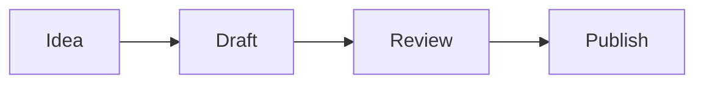

# Agents, engines and models

Source: concepts/ai.md
URL: /concepts/ai

Rhizome lets you choose what runs Chat: Prime Agent or Rhizome's own engine. Whichever you use, the vault, the permissions and the saved memory stay the same.

## Terms on this page

- **Agent loop:** the cycle that sends your message to a model, runs the tools the model asks for, and repeats until the answer is done.
- **Engine:** what runs that loop for Chat.
- **Model:** the language model the engine talks to, hosted or running locally.
- **Tool:** an action the agent can take, such as creating a note or running a command.

## Engines for Chat

| Engine | What it is | Good for |
|---|---|---|
| **Prime Agent** (default) | A separate harness Rhizome connects to. It runs sessions, tools, skills and provider login | Real agent work today: reading, searching and editing files, long runs, Prime packages |
| **Rhizome's engine** | Rhizome's own loop, built into the app. It doesn't need Prime | Choosing your own providers, including free models. Early: it can create notes, but can't read, search or edit files yet |

Switch with **Chat engine** in Settings → AI Agents. When it's on, new chats use Rhizome's engine and never call Prime, even if Prime isn't installed. The switch is only in Settings, not in the message box.

### Rhizome's engine

- **Models:** pick a catalog model, or **Taproot**. See [Free models and routing](free-models-and-routing.md). Anthropic models aren't offered here yet.
- **Tools:** `echo` and `create_note`. Power User adds `bash`. Rhizome asks you to approve each `bash` call, but `bash` doesn't run a shell yet. There are no tools to read, search or edit files, and the agent can't search the vault or old sessions.
- **Saved chats:** each chat is saved as it goes and can be reopened after you quit. Chats get a title automatically from the first exchange.
- **Errors:** a problem that doesn't stop the turn shows as a notice in the chat. A problem that does stop it, such as a missing key, ends the turn with a message that says what to fix.

### Prime Agent

Prime runs as a background service (a daemon) that Rhizome connects to. Prime owns its sessions (`~/.prime/agent/sessions/`) and its packages (Settings → Packages). Packages can use the whole machine; a vault isn't a sandbox for them.

Prime handles its own provider login. Sign in from Settings → AI Agents → Local agent, where each provider card (Anthropic, OpenAI Codex, xAI, DeepSeek and others) has a **Sign in** or **Reconnect** button. Or run `prime-agent` in a terminal and use `/login`. Prime's model list includes Anthropic models.

The same tab lists **Recognized local agents**, Prime's default model, and which models Prime may use.

## Permission modes

A **permission mode** decides what the agent may do without asking. It's set per vault.

| Mode | Rhizome's engine |
|---|---|
| **Limited tools** | `echo` and `create_note`. Asks before each note it creates |
| **Power User** | Creates notes without asking. Adds `bash`, which asks every time and doesn't run a shell yet |

Prime has no sandbox, so Prime chats always run as Power User. While Prime is the default AI target, chats on Rhizome's engine also run as Power User.

## Plugins

Rhizome will have its own plugin system: add a tool, hook into a turn, or block a tool call. It's planned, not shipped. Today, Prime packages extend Prime, and MCP lets other apps use your vault.

## Let other apps use your vault (MCP)

**MCP** (Model Context Protocol) lets other AI apps call Rhizome's tools. With it, an MCP client such as Claude Code or Cursor can read and write your vault.

Run **Set Up External AI Tools…** from the command palette (⌘K). Rhizome shows which config files it will change (for example `~/.claude.json` and `~/.cursor/mcp.json`) and writes nothing until you confirm. It needs Node.js 18 or newer, or Bun, on your `PATH`. To paste the entry yourself, use **Copy MCP config** in Settings → AI Agents → Local agent.

## Review what the agent changed

Agent edits are file edits. In a Git-backed vault, review them in the Changes view, look at the diff, and commit or revert. Save chat results you want to keep with **Save to vault**. See [Your vault is the agent's memory](vault-as-memory.md).

---

# Editor

Source: concepts/editor.md
URL: /concepts/editor

Rhizome offers a rich editor for daily writing and a raw Markdown mode for exact file control. Both modes write back to the same Markdown file.

## Rich editing

The rich editor supports blocks, slash commands, wikilinks, tables, code blocks, images, Mermaid diagrams, LaTeX-style math, and markdown-backed whiteboards.

Use it when you want to write and reorganize quickly without thinking about Markdown syntax.

## Raw mode

Raw mode shows the Markdown source directly. Use it when you need to edit YAML frontmatter, repair unusual Markdown, or make an exact text change.

Toggle raw mode with `Cmd+\` on macOS or `Ctrl+\` on Windows and Linux.

## Table of contents

The table of contents panel builds an outline from the headings in the current note, updates as you type, and jumps to a section when you click it. It's useful for long notes, procedures, research files, and generated documents. If a note has no useful headings, add clear H2 and H3 sections.

Open it from the editor toolbar, the command palette, or with `Cmd+Shift+T` on macOS (`Ctrl+Shift+T` on Windows and Linux).

## Width

Notes can use normal or wide editor width. Set the default in Settings, or override an individual note from the editor toolbar.

---

# Files, PDFs and media

Source: concepts/files-and-media.md
URL: /concepts/files-and-media

Rhizome starts with Markdown notes, but a vault can also contain images, PDFs, media files, whiteboards, and other local files.

## Previews

Select an image, PDF, media file, or other file from a folder or file list. Rhizome previews common image files, PDFs, and supported media files in the app. Other files open in the default system app.

Settings control whether PDFs, images, and unsupported files appear in All Notes. Folder browsing still shows files in their folders.

If a preview doesn't render, open the file in the default app to check that it's valid. Then check that the file is inside the active vault and isn't blocked by operating-system permissions.

## Attachments

When you paste or drop an image into a note, Rhizome copies it into the vault and links the copy from the Markdown. Attachments are normal files, so other tools can open them.

## Diagrams

Use Mermaid code blocks when a note needs a diagram that should stay plain text and versionable.

````md

````

Rhizome renders Mermaid diagrams in the editor while keeping the source in Markdown.

## Whiteboards

Whiteboards use tldraw in the editor, but their durable representation stays in Markdown. That keeps them inside the vault and versioned by Git with the rest of your notes.

## Git boundary

If generated or local-only files are ignored by Git, Rhizome can hide them from notes, search, quick open, and folders. Use this when build artifacts or private local files should not behave like vault content.

---

# Free models and routing

Source: concepts/free-models-and-routing.md
URL: /concepts/free-models-and-routing

**Taproot** is Rhizome's free automatic router. It runs Chat on free hosted models without you picking one. It tries free providers in a fixed order. When a provider fails, rate-limits you or runs out of free use, Rhizome moves to the next one. You can add your own endpoint as the last stop.

This works with Rhizome's own engine. Choose **Taproot** in the model picker.

## What you get

- **No model shopping.** One choice, and Rhizome picks a working free model for each step.
- **Fewer dead ends.** A provider that's down or out of quota is skipped for a while instead of failing your chat.
- **No surprise restarts.** Rhizome switches provider only before any reply text arrives. Once the model has started answering or called a tool, an error ends that step. The half-finished answer isn't silently started again somewhere else.
- **Your keys stay on your computer.** Each provider needs its own free API key, kept in the OS keychain.
- **Your prompts aren't used for training.** Models whose free tier trains on prompts are left out of the list Rhizome routes to, along with free tiers that don't renew or have poor terms.

## The providers

In order:

1. Groq
2. Mistral
3. LLM7
4. OpenRouter (free models only)
5. NVIDIA NIM
6. Your own endpoint, if you picked one

Cloudflare Workers AI is off by default. It needs an account ID as well as a key, and turning it on shows a billing warning first. When on, it's tried after NVIDIA NIM.

The order is fixed. Settings shows it read-only under **Fallback order**.

## Set it up

1. In Settings → AI Agents, open the **API model** tab and find **Taproot**.
2. For each provider you want, turn it on and paste its API key. The row shows **Key saved**, **No key**, or **Keychain error** if the keychain is locked or access was denied.
3. Optional: choose an **Own endpoint** and **Own endpoint model**: any OpenAI-compatible server you've set up as a provider, local or hosted.
4. Optional: turn on **Strict mode**. It uses only providers that document a hard stop at the free limit (Groq today), plus your own endpoint.
5. In the model picker, choose **Taproot**. Until at least one provider has a key, Settings says "Add a key to at least one provider to use Taproot."

## How a provider gets skipped

Rhizome keeps three kinds of cooldown:

- **Provider:** after repeated timeouts or server errors, the provider is paused and tried again later.
- **Key:** a key that's rate-limited cools down on its own.
- **Model:** a model that's out of quota is locked out. A daily quota stays locked until it resets at midnight UTC.

Each step has a 45-second budget for retries. Your own endpoint is still tried after the budget runs out.

## Things to know

- Free tiers change. A provider's limits, terms and models are set by that provider, not by Rhizome.
- Some free tiers are for prototyping and evaluation only.
- Settings doesn't show each provider's terms or training policy. Models that train on prompts are left out automatically, but check a provider's terms yourself before using it for real work.
- Anthropic models aren't offered by Rhizome's own engine yet. To use Claude, use Prime and sign in on the Anthropic card in Settings → AI Agents → Local agent. See [Agents, engines and models](ai.md).

## Credits

- [OmniRoute](https://github.com/diegosouzapw/OmniRoute) (MIT) © 2026 diegosouzapw: the provider catalog data and cooldown rules are ported from it.
- [freellmapi](https://github.com/tashfeenahmed/freellmapi) (MIT): used as an edge-case checklist for retries and failover. No code or hosted catalog is copied.

See [Credits and licences](../reference/credits.md).

## Related

- [Set up models and keys](../guides/configure-ai-models.md)
- [Agents, engines and models](ai.md)

---

# Git

Source: concepts/git.md
URL: /concepts/git

Git is Rhizome's recommended history and sync layer. Rhizome can work with plain Markdown folders, and Git unlocks local history, recovery, remote backup, and multi-device workflows when you want them.

Rhizome acts as a lightweight Git client for your vault. You can review changes, commit, pull, push, and inspect history without leaving the app.

## What Rhizome uses Git for

- Whole-vault commit history.
- Current diff for the vault.
- Per-note history.
- Current diff for an individual note.
- Pull and push.
- Conflict detection and resolution.
- Remote connection for local-only vaults.

## History and diffs

Each note can show its own history and current diff, so you can understand how that file changed over time or what is unsaved relative to Git.

Rhizome also shows a history of the whole vault. Use it when you want to review broader changes across multiple notes before committing or syncing.

## Local commits

You can commit changes inside Rhizome without leaving the app. This gives you useful restore points even before a remote is configured.

## Review what the agent changed

The agent's edits and saved notes are file changes like yours. In a Git-backed vault:

1. Open **Changes**, next to All Notes in the sidebar, to see every changed file.
2. Open a file's diff to see exactly what changed.
3. Commit what you want to keep, or revert what you don't.

Keep agent work in small commits, so one bad change is easy to undo. See [Your vault is the agent's memory](vault-as-memory.md).

## Remotes

Connect a compatible Git remote when you want sync or backup. Rhizome relies on your system Git authentication, so GitHub CLI, SSH keys, credential helpers, and existing Git configuration can continue to work.

---

# Inbox

Source: concepts/inbox.md
URL: /concepts/inbox

The Inbox is for notes that have been captured but not yet organized.

## Why it exists

Fast capture should not require perfect structure. The Inbox gives you a place to put incomplete notes, then process them later.

The Inbox workflow is optional. Turn it off in Settings → Workflow if you prefer every note to appear organized by default.

## Organizing Inbox notes

The review checklist is in [Organize the Inbox](../guides/organize-inbox.md).

## Keep it small

Keep the Inbox small enough that it can be reviewed in one focused pass. Rhizome works best when capture is fast and organization is deliberate.

---

# Mycelium

Source: concepts/mycelium.md
URL: /concepts/mycelium

Mycelium shows where an agent run went. It draws the folder the run worked in as a map of files, and lights up each file the agent searched, read or edited. Use it to see a run's scope at a glance, find where it went in circles, or check which files a run touched before something broke.

Mycelium uses [Mindwalk](https://github.com/cosmtrek/mindwalk) (MIT) © 2026 Ricko Yu. Mindwalk replays coding-agent sessions on a city map of a repository. You install it yourself; Rhizome doesn't include it or rebrand it.

## What you see

- **The map.** Each file in the folder is a building. The layout is fixed for a given folder, so the same file is always in the same place and two runs can be compared by eye.
- **The footprint.** Files the run searched, read or edited are highlighted. A tight cluster means a focused run. Scattered light, or the same files lit again and again, means the agent was searching or going in circles.
- **Sessions.** A column lists past sessions by title. Pick one to see its footprint, or look at the overview across all sessions.

## Before you start

1. Install Mindwalk so that the `mindwalk` program is on your path. See [Mindwalk](https://github.com/cosmtrek/mindwalk) for install steps.
2. Chat with Prime as the engine. Mycelium reads Prime sessions from `~/.prime/agent/sessions/`. It doesn't show chats from Rhizome's own engine, and the agent can't search old Mycelium sessions.

If Mindwalk is missing, Mycelium says **Install Mindwalk, then retry**.

## Open it

- In Chat, click the **Mycelium** button in the Prime session header to see the current session's footprint.
- In the sessions list, right-click a Prime session and choose **Show in Mycelium**.
- From the **Views** group on the left rail, choose Mycelium. The shortcut is Ctrl+⌘3 on a Mac and Ctrl+Shift+3 on Windows.

## Find what touched a broken file

Mycelium can't filter sessions by file yet, but the map makes it quick to check by eye:

1. Open Mycelium and look at the overview across sessions.
2. Find the file on the map. It's always in the same place.
3. Open the sessions where it lights up, newest first.
4. Open that session's chat to see what the agent did, and the vault or repository history to see the change.

## What it needs

- **A session that used tools.** A chat with no file activity draws an empty map.
- **A real working folder.** The map is drawn from the folder the run worked in. A run that only touched the vault draws a small, sparse map.

## What it isn't

Mycelium shows where a run went. It doesn't save anything to memory and doesn't replace Git. For what's in the vault, use the Graph view (see [Relationships](relationships.md)). For what changed, use the Changes view and [Git](git.md).

## Related

- [Your vault is the agent's memory](vault-as-memory.md)
- [Chat with the agent](../guides/use-ai-panel.md)

---

# Notes

Source: concepts/notes.md
URL: /concepts/notes

A note is a Markdown file with optional YAML frontmatter. Rhizome reads the first H1 as the primary title and keeps the file on disk as the durable representation.

## Anatomy

```md
---
type: Project
status: Active
belongs_to:
  - "[[workspace]]"
---

# Launch Documentation

Draft the public Rhizome docs and keep them close to code changes.
```

## Titles

The first H1 is the note title. Rhizome uses that title wherever the note is displayed: note lists, search results, wikilink suggestions, relationship pickers, tabs, and window titles.

The title is separate from the filename. The filename stays visible in the breadcrumb so you can see the file on disk, and you can rename it independently when needed.

Use the breadcrumb action to rename the file to match the title. New untitled notes can also auto-rename from the first H1 the first time they get a real title. Turn this off with **Auto-rename untitled notes from first H1** in Settings if you prefer filenames to stay unchanged until you rename them manually.

## Body links

Use `[[wikilinks]]` to connect notes from the body. Rhizome shows autocomplete suggestions while you type, and links can resolve by filename or title.

## Frontmatter

Use frontmatter for structured fields such as type, status, date, URL, and relationships. Keep free-form thinking in the body.

Some notes can be displayed with specialized editors while keeping the same file-first model. A note with `_display: sheet` opens as a spreadsheet and stores its cells in a CSV-like body, while `type` remains available for organization. See [Spreadsheets](spreadsheets.md).

---

# Properties

Source: concepts/properties.md
URL: /concepts/properties

Properties are frontmatter fields that Rhizome can display, filter, and edit.

## Suggested properties

Suggested properties are the fields Rhizome knows how to create quickly from the Properties panel. When a suggested property is missing, the panel shows a shortcut to add it with the right editor.

| Field | Purpose |
| --- | --- |
| `type` | Groups the note into a type such as Project, Person, or Topic. |
| `status` | Tracks lifecycle state such as Active, Done, or Blocked. |
| `url` | Stores a canonical external link. |
| `date` | Represents a single date. |

## System properties

Fields that start with `_` are system properties. They remain in plain text but are hidden from normal property editing.

Examples include `_icon`, `_color`, `_order`, `_sidebar_label`, `_width`, and `_pinned_properties` on type documents or notes.

## Property editing

The Properties panel is the safest place to edit structured properties. Toggle it with `Cmd+Shift+I` on macOS or `Ctrl+Shift+I` on Windows and Linux.

Date fields use Rhizome's picker, relationship fields can use wikilinks, and raw Markdown mode is available when you need direct control over YAML.

---

# Relationships

Source: concepts/relationships.md
URL: /concepts/relationships

Relationships make a vault feel like a graph instead of a pile of documents.

## Relationship fields

Any frontmatter field containing wikilinks can become a relationship. Relationship fields can point to one note or to an array of notes.

```yaml
belongs_to:
  - "[[product-work]]"
related_to:
  - "[[documentation]]"
  - "[[editor-research]]"
blocked_by:
  - "[[release-process]]"
  - "[[sync-conflicts]]"
```

Rhizome supports default relationship fields out of the box: `belongs_to`, `has`, and `related_to`. It also detects custom relationship fields dynamically when they contain wikilinks.

Default relationships have automatically computed inverses. If a note says it `belongs_to` a project, the project can show that note under its inverse `has` relationship without you writing the reverse link by hand. `related_to` works as a lateral relationship in both directions.

These outgoing and inverse relationships appear in the Properties panel and in Neighborhood mode, where the note list becomes a graph view around the selected note.

## Wikilinks

Wikilinks connect notes by name:

```md
This project belongs to [[content-systems]] and is related to [[git-workflows]].
```

Rhizome suggests targets while you type. Links can resolve by filename or title, so prefer clear titles and filenames.

## Body links versus relationship fields

Use body links when the relationship appears naturally in writing. Use frontmatter relationships when the connection is important enough to show in navigation, filters, Neighborhood mode, or the Properties panel.

## Backlinks

Rhizome can show incoming links and inverse relationships, making it easier to navigate from a note to the rest of its context.

To see all the links in the vault at once, use the [Wiki Graph](wiki-graph.md).

---

# Spreadsheets

Source: concepts/spreadsheets.md
URL: /concepts/spreadsheets

Rhizome sheets are spreadsheet notes. They keep the same file-first model as other notes, but a note with `_display: sheet` opens in a spreadsheet editor instead of the rich text editor. The note's `type` remains available for organization.

The durable file is still Markdown with YAML frontmatter. The body is CSV-like text containing cell inputs and formulas, and spreadsheet presentation state is stored as plain YAML under `_sheet`.

## Read next

- [Use Spreadsheets](../guides/use-spreadsheets.md) for the editing workflow.
- [Spreadsheet File Format](../reference/spreadsheet-format.md) for the plain-text storage contract.
- [Spreadsheet Formulas](../reference/spreadsheet-functions.md) for formula syntax, autocomplete, and IronCalc function families.

## Why sheet notes

Sheets are useful when information is better modeled as rows, columns, and formulas than as prose. Examples include budgets, revenue models, inventories, editorial calendars, lightweight trackers, and analytical scratchpads.

Rhizome does not store sheets as opaque workbook binaries. A sheet should remain:

- readable in a text editor
- diffable in Git
- editable by humans and AI agents
- available offline
- connected to the rest of the vault through types, properties, relationships, and wikilinks

## One note, one sheet

A sheet note is a single sheet. Rhizome does not expose multiple tabs inside one note.

When a model needs more than one table, create more than one sheet note and connect them with wikilinks or cross-sheet formulas. This keeps each file small, legible, and aligned with Rhizome's graph model.

For example:

- `newsletter-revenue.md`
- `sponsorship-pipeline.md`
- `refactoring-business-plan.md`

Each can be a normal `_display: sheet` note, and formulas can reference cells in another sheet note with Rhizome's wikilink cell syntax.

## Editing

The interactive sheet editor is backed by IronCalc. Rhizome uses IronCalc for spreadsheet behavior and formula evaluation, then adapts the workbook back to Rhizome's plain-text note format.

In the sheet editor:

- cell inputs that start with `=` are formulas
- non-formula cells can contain normal text, numbers, dates, and `[[wikilinks]]`
- typing `[[` in a cell opens the same note autocomplete concept used elsewhere in Rhizome
- typing a formula function name opens inline formula autocomplete for the bundled IronCalc function catalog
- right-clicking a selection exposes core formatting controls such as number formats, decimal precision, bold, italic, and clear formatting

Keyboard basics follow spreadsheet conventions:

- arrow keys move the active cell
- `Shift` with arrows extends the selection
- `Enter` starts editing the active cell
- `Escape` exits cell editing while keeping focus in the sheet
- `Delete` or `Backspace` clears the selected range
- copy and paste should preserve formulas, including Rhizome cross-sheet references

## Wikilinks in cells

Wikilinks in non-formula cells are stored as normal Rhizome wikilinks:

```csv
Project,Owner,Status
[[website-redesign]],[[person/alice]],Active
[[sponsorship-pipeline]],[[person/matteo]],Review
```

The cell still behaves like a spreadsheet cell, but the value remains a vault link that Rhizome can understand.

## Cross-sheet formulas

Rhizome adds a sheet-note reference syntax on top of IronCalc formulas:

```txt
=[[newsletter-revenue]].B5
=SUM(B2:D2)+[[sponsorship-pipeline]].E12
=[[refactoring-business-plan]].$C$18
```

The target before the dot is a normal Rhizome wikilink target. The part after the dot is an A1-style cell address.

Relative and absolute references work like spreadsheet references when copied:

- `[[revenue]].B5` can shift when pasted to another cell
- `[[revenue]].$B$5` stays fixed
- `[[revenue]].B$5` fixes the row
- `[[revenue]].$B5` fixes the column

This is not the same as an IronCalc workbook tab reference. It is Rhizome-specific syntax for referencing another sheet note in the vault.

Current cross-sheet formulas resolve single cells. Ranges across sheet notes are not a stable file-format feature yet, so prefer composing them from explicit cell references or keeping range formulas inside the same sheet note.

## Storage

A minimal sheet note looks like this:

```md
---
type: Project
_display: sheet
status: Draft
belongs_to:
  - "[[business-plan]]"
_sheet:
  frozen_rows: 1
  columns:
    A:
      width: 180
  cells:
    E6:
      num_fmt: "0.00%"
---
Metric,January,February,March,Q1 Total
Subscriptions,1200,1350,1500,=SUM(B2:D2)
Services,800,900,750,=SUM(B3:D3)
Expenses,650,700,760,=SUM(B4:D4)
Net,=B2+B3-B4,=C2+C3-C4,=D2+D3-D4,=SUM(B5:D5)
Growth,,=(C5-B5)/B5,=(D5-C5)/C5,=(E5-B5)/B5
```

Normal frontmatter stays normal Rhizome metadata. `_sheet` is system metadata for the spreadsheet editor and is hidden from normal property editing.

For the full storage contract, see [Spreadsheet File Format](../reference/spreadsheet-format.md).

## Formulas

Rhizome delegates formula calculation to IronCalc. IronCalc aims for Excel-compatible formulas, while its project documentation still describes it as work in progress. For Rhizome-specific formula behavior and the autocomplete function catalog, see [Spreadsheet Formulas](../reference/spreadsheet-functions.md).

---

# Types

Source: concepts/types.md
URL: /concepts/types

Types describe what kind of thing a note represents: Project, Person, Topic, Procedure, Event, or any category you create.

## Type field

The `type:` field assigns a note to a type.

```yaml
type: Project
```

Rhizome does not infer type from folder location. Moving a file into another folder does not change its type.

## Prefer types over folders

Types are the preferred way to group notes in Rhizome. Folders are supported for existing vaults and fallback organization, but Rhizome is built around types and relationships because they carry stronger meaning than file paths.

Use types for semantic groups such as Projects, People, Topics, Procedures, Events, and Essays. Use relationships to connect notes across those groups. This gives Rhizome better structure for navigation, filtering, properties, templates, and future automation than folder location alone.

## Type documents

Type documents are Markdown notes with `type: Type` in frontmatter. They describe how a type should appear and what new notes of that type should start with.
Use Phosphor icon names in kebab-case for `_icon`, such as `folder` or `briefcase`.

```yaml
---
type: Type
_icon: folder
_color: blue
_sidebar_label: Projects
_order: 10
---

# Project
```

Type templates can live in the Type document's `template` frontmatter field. When a hand-edited Type body contains template-like structure after its own `# TypeName` heading, Rhizome also uses that body content as the new-note template. Plain descriptive body text stays documentation-only.

## What types control

- Sidebar grouping.
- Type icon and color.
- Sidebar order and label.
- Pinned properties.
- New-note templates.

## New note defaults

Type documents can define empty properties and relationships. When you create a new note of that type, Rhizome shows placeholders for those fields so you can fill them in from the Properties panel.

If a type document gives a property a value, that value becomes the default for new notes of that type. For example, a Project type can define `status: Active` so every new project starts active until you change it.

---

# Your vault is the agent's memory

Source: concepts/vault-as-memory.md
URL: /concepts/vault-as-memory

The agent's long-term memory is your vault: a folder of Markdown files you can read, edit, search and version yourself. Nothing the agent "knows" between chats is hidden from you.

## What you get

- **You decide what's remembered.** Knowledge reaches the vault when you save it, not as a side effect of every chat.
- **Recall shows its source.** When a Prime answer uses a vault note, it's marked **From your vault**, so you can open the note and check.
- **Memory is reversible.** In a Git-backed vault, every saved or edited note is a change you can diff and revert.
- **Memory is portable.** It's plain Markdown. Open it in another editor, sync it with Git, or keep it if you stop using Rhizome.

## The memory loop

1. **Chat.** You and the agent work on something. Chat transcripts are working memory. They live with the session, not in the vault.
2. **Save.** Under a reply worth keeping, click **Save to vault**. Rhizome writes a Markdown note.
3. **Recall.** With Prime as the engine, the agent can search and open vault notes in later chats. An answer built on a note shows it came from your vault. Rhizome's own engine can't read or search the vault yet.
4. **Review.** Open, edit or delete the note like any other. With Git, look at its history and revert a change.

## Save to vault

**Save to vault** appears under a reply. It writes the note straight away. There's no preview or diff step, so review the note afterwards, or use Git to undo it.

It refuses to save when:

- **The reply is empty.** There's nothing to save.
- **No vault is attached** to the chat. It says "Attach a vault to save chat into notes".
- **The text contains a credential**, such as an API key or password. Vault notes are committed and can be pushed, so remove the secret first.
- **The same reply is already in the vault.** It names the existing note and doesn't overwrite it.

### Automatic saves are off by default

Settings → AI Agents → **Auto-save chat knowledge to the vault** saves durable decisions to the vault after each turn. It's off by default. Turn it on only if you want saves to happen without a click. Explicit saves are easier to trust.

## Bring in past chats

You can import your Claude Code chat history from Settings → AI Agents → **Import chat history**. Rhizome scans `~/.claude/projects` on your Mac. The chats become notes under `Imports/claude-code/` in the vault. A second import skips chats that are already there. Claude Code is the only source today.

## Why Git matters here

Git turns the vault into memory with a history:

- **Diff:** see what a note said before the agent or you changed it.
- **Revert:** undo one change without touching the rest.
- **Sync:** push the vault to a remote you control. Rhizome uses your system Git login.

Git is optional. A plain folder works, but it has no history to go back to. See [Git](git.md).

## What the agent reads first

A vault can hold an `AGENTS.md` file with your conventions: how notes are named, which types to use, what to avoid. The agent reads it before it works in the vault. `CLAUDE.md` is kept as a compatibility copy for tools that look for that name.

## Where things live

| What | Kept in | You can |
|---|---|---|
| Saved notes | The vault | Read, edit, diff, revert, sync |
| Imported Claude Code chats | `Imports/claude-code/` in the vault | Read, edit, link |
| Chat transcripts (Prime) | `~/.prime/agent/sessions/` | Resume from the sessions list |
| Chat transcripts (Rhizome's engine) | `native-sessions/` in the app config folder | Resume from the sessions list |
| Vault activity log | `.rhizome/events.jsonl` in the vault | Inspect |

## Related

- [Mycelium](mycelium.md): see which files a Prime run touched.
- [Vaults](vaults.md) · [Git](git.md) · [Chat with the agent](../guides/use-ai-panel.md)

---

# Vaults

Source: concepts/vaults.md
URL: /concepts/vaults

A vault is the folder Rhizome reads and writes. The filesystem is the source of truth; the app state and cache are derived from files.

## Core rules

- Notes are Markdown files.
- YAML frontmatter provides structure.
- Attachments are normal files inside the vault.
- Type definitions and saved views are also files.
- Git can track history and support remote sync.

## Why local files matter

Local files keep your notes inspectable. You can open them in another editor, search with command-line tools, back them up with your own system, and version them with Git.

Rhizome should never become the only way to read your data.

## Git is a capability

A plain folder of Markdown files can open as a vault. Git-backed vaults unlock history, changes, commits, pull, push, conflict handling, and remote setup.

If a folder is not a Git repository, Rhizome can initialize Git when you explicitly ask it to. It avoids initializing broad personal folders such as Desktop, Documents, or Downloads unless they are clearly dedicated vault folders.

## Multiple vaults at the same time

Rhizome can load multiple registered vaults into one unified graph. Turn on **Use multiple vaults at the same time** in Settings → Vaults.

After the option is enabled, open the bottom-left vault menu to include or exclude vaults from the graph. Included vaults appear together in note lists, search, quick open, backlinks, and wikilink navigation. Each note keeps a compact vault badge when Rhizome needs to disambiguate where it lives.

The selected vault still matters. Git status, commits, sync, folder navigation, saved views, and vault repair actions stay scoped to the current repository. Use `Manage vaults` from the vault menu or the Vaults settings section to rename vaults, choose colors, and set the default destination for new notes.

Cross-vault wikilinks use the target vault's stable alias when needed, for example `[[team/projects/alpha]]`. Links inside the same vault stay normal vault-relative links.

## App state versus vault state

Vault-level information should travel with the vault. Machine-specific preferences stay with the app installation.

| Vault state | App state |
| --- | --- |
| Type icons and colors | Editor zoom |
| Saved views | Window size |
| Pinned properties | Recent vault list |
| Relationship conventions | Local cache |
| Vault AI guidance files (`AGENTS.md`, `CLAUDE.md`) | AI target and Chat engine |
| Permission mode | Provider keys (in the system keychain) |
| Auto-save chat knowledge setting | Chat logs from Rhizome's engine (`native-sessions/`) |

---

# Wiki Graph

Source: concepts/wiki-graph.md
URL: /concepts/wiki-graph

The Wiki Graph shows your vault as a map. Each note is a dot, and each link between notes is a line. Use it to see which notes hold your ideas together, and which ideas you've linked to but haven't written up yet.

## Open it

Choose **Graph** in the **Views** group on the left rail. The shortcut is Ctrl+⌘2 on a Mac and Ctrl+Shift+2 on Windows.

If the vault has no links yet, the graph says "No linked notes yet — create wikilinks to grow the graph." See [Relationships](relationships.md) for how to link notes.

## What you see

- **Notes**, coloured by type. Notes with no type are marked **Untyped**.
- **Links**, drawn differently for each kind: a **Wikilink** in the body, **Belongs to**, **Related to**, and other relationship fields.
- **Notes that aren't created yet.** A note other notes link to, but that doesn't exist as a file, shows as "Not created yet". Select it and choose **Create note** to write it.

The key in the corner counts notes, links and notes not yet created.

## Find and focus

- **Find a note…** searches the graph by title.
- Turn types off to hide those notes. If every note is hidden, turn a type back on.
- **Local graph** shows only the selected note and its neighbours. **Full graph** goes back to the whole vault.
- Each note shows how many links and backlinks it has. **Open note** opens it in the editor.

## Keyboard

Arrow keys move between notes. Enter opens the selected note. Esc backs out of the local graph, then out of the graph.

## Related

- [Relationships](relationships.md)
- [Mycelium](mycelium.md): where an agent run went, instead of how notes link.