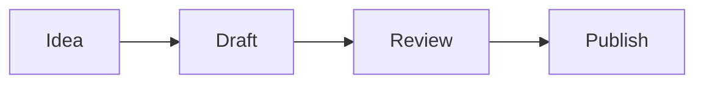

# Files, PDFs and media

Source: concepts/files-and-media.md
URL: /concepts/files-and-media

Rhizome starts with Markdown notes, but a vault can also contain images, PDFs, media files, whiteboards, and other local files.

## Previews

Select an image, PDF, media file, or other file from a folder or file list. Rhizome previews common image files, PDFs, and supported media files in the app. Other files open in the default system app.

Settings control whether PDFs, images, and unsupported files appear in All Notes. Folder browsing still shows files in their folders.

If a preview doesn't render, open the file in the default app to check that it's valid. Then check that the file is inside the active vault and isn't blocked by operating-system permissions.

## Attachments

When you paste or drop an image into a note, Rhizome copies it into the vault and links the copy from the Markdown. Attachments are normal files, so other tools can open them.

## Diagrams

Use Mermaid code blocks when a note needs a diagram that should stay plain text and versionable.

````md

````

Rhizome renders Mermaid diagrams in the editor while keeping the source in Markdown.

## Whiteboards

Whiteboards use tldraw in the editor, but their durable representation stays in Markdown. That keeps them inside the vault and versioned by Git with the rest of your notes.

## Git boundary

If generated or local-only files are ignored by Git, Rhizome can hide them from notes, search, quick open, and folders. Use this when build artifacts or private local files should not behave like vault content.